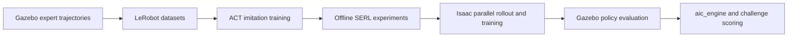

# Working on the hybrid training branch

**October 1 supervised sequence:** One shared temporal transport actor first, then a task-conditioned selected-port perception model, then a separate port-relative insertion actor with a stable observation-only handoff. The bounded frozen-feature temporal/no-history comparison and one direct-state repair finished below the offline subgoal gate; no new autonomous rollout, insertion, or RL result is claimed. [Plan and audit](experiments/2026-10-01-temporal-three-model-continuation.md).

**October 1 latest:** The 104 successful SC Low Lateral Bypass teacher episodes have an independently audited motion-safe BC derivative: 83 train/21 validation, 69,681 transport and 26,455 local chunks. Four supervised transport checkpoints completed a two-scene, two-action-cap Gazebo comparison: **0/16 insertions and 0/16 stable handoffs within 10 mm**. The later test above explicitly predicted route progress and subgoals and failed its offline gate; local handoff, RL, and final scenes remain gated. [Dataset, rollouts, and next test](experiments/2026-10-01-sc-llb-cleaned-bc.md), [status](STATUS.md).

**September 30 latest:** teacher transport gate accepted. Two same-world Cartesian SC teachers fully inserted, providing v9 with 1,751 transport and 503 local chunks, plus the verified SFP source. The balanced-port BC retry finished 1,500 updates and failed both autonomous development starts: final planned-standoff errors 103 and 603 mm versus 76 and 74 mm for the prior masked actor; neither reached handoff or inserted. A bounded trace/video audit found early wrong-route commands without sustained cable snag. Stop routine feed-forward BC. A checkpoint-provenance audit found that this run reused the full action head from an older mixed-SC-route model and had only two new SC episodes; it was not a clean test of the new Low Lateral Bypass route. Audit clean route data and initialization before deciding on a route-subgoal model. No new training was started for this audit. True visibility, autonomous two-actor insertion and RL remain gated; reserved final scenes stay sealed. [Evidence and exact artifacts](experiments/2026-09-30-transport-to-two-actor-continuation.md).

**September 30 continuation:** transport gate accepted. Four changed-card-layout MoveIt replays reached handoff/standoff; one fully inserted, one failed local insertion and is excluded from expert BC, two were transport-only validation. Four full-success SC teacher episodes now provide 3,001 transport and 1,000 local training chunks, with 1,751 held-out transport chunks. True-visibility recorder checks caught invalid auxiliary depth during tilt; labels are being repaired before training. Autonomous two-actor insertion and RL remain pending. [Execution record](experiments/2026-09-30-transport-to-two-actor-continuation.md).

**September 30 force audit:** start with the [oracle diagnosis](experiments/2026-09-30-force-oracle.md): close-view contact markers, wrist-versus-contact force distinction, measured retreat failure, upstream Gazebo reporting bug, and unchanged-collision route validation.

Start here when returning to this repository. These pages describe the local
`feat/hybrid-train` work; the original toolkit guide remains in the
[repository README](../README.md).

| Question | Maintained page |
| --- | --- |
| Is there a concise project overview with results and visual examples? | [Robotic cable insertion project writeup](robotic_cable_insertion_project.md) |
| What works, what is unresolved, and what should we do next? | [Current status](STATUS.md) |
| Did moving the SC wrist tilt before the return help? | [Five-card port-1 MoveIt pilot, measured plug-tip swing, matched control, and video](experiments/2026-09-30-sc-tilt-before-return.md) |
| Did lowering the MoveIt SC route avoid a sustained snag and permit insertion? | [Low-cross continuation, measured heights, both ports, insertion success/failures, and videos](experiments/2026-09-29-moveit-low-cross-continuation.md) |
| What did the original higher MoveIt corridor show? | [Fixed-scene baseline pilot and its original clearance gate](experiments/2026-09-29-moveit-sc-route-pilot.md) |
| Did the farther SC cable route clear the cards and survive ±1 cm changes? | [Five-card route sensitivity, videos, and stopped gate](experiments/2026-09-26-sc-far-return-route-sensitivity.md) |
| How would selected-port visibility, confidence, and the two actors be trained and switched? | [Task-conditioned perception and actor handoff](POSE_VISIBILITY_HANDOFF.md) |
| Where is the current ACT run? | [All-eligible, task-conditioned ACT](experiments/2026-09-18-act-all-verified.md) |
| Where are the previous ACT results and rollout videos? | [Earlier verified-data ACT experiment](experiments/2026-09-17-act-verified-8h.md) |
| What did the world-model pilot show? | [Dreamer pilot](experiments/2026-09-18-dreamer-pilot.md) and [paired follow-up](experiments/2026-09-18-world-followup.md) |
| Did world pretraining help the supervised policy? | [Matched initialization comparison](experiments/2026-09-18-world-supervised-init-ablation.md) |
| What did the world-model follow-up require, and what remains? | [World-model next steps](WORLD_MODEL_NEXT_STEPS.md) |
| How did the full verified-data world run perform? | [Full tokenizer, dynamics, and final evaluation](experiments/2026-09-19-full-world-training.md) |
| What happened in the Isaac transfer, guided policy head, and supervised pose-probe experiments? | [Isaac execution record](experiments/2026-09-20-isaac-world-policy-rl.md) |
| Why did we choose perception, supervised control, and then gated model-free RL? | [Perception-to-RL decision and result](experiments/2026-09-20-perception-supervised-rl.md) |
| How did causal temporal and multi-view perception handle cable occlusion? | [Design, papers, setting gaps, execution, and result](experiments/2026-09-21-temporal-multiview-perception-plan.md) |
| What happened with force-safe cable resets and natural guided cable trajectories? | [Cable reset, handoff audit, static/natural comparison, held-out-shape result, and frozen error-tail audit](experiments/2026-09-22-cable-visibility-perception.md) |
| Did frozen pose conditioning improve the supervised controller? | [Matched GRU architecture, training, autonomous rollouts, pose-reliance audit, and stop decision](experiments/2026-09-22-pose-conditioned-gru-policy.md) |
| Did forcing pose through an explicit correction path help? | [Balanced corrective collection, mandatory pose residual, counterfactual gate, and stop decision](experiments/2026-09-22-explicit-pose-correction.md) |
| What happened with port-relative RPDP BC and DPPO? | [Action/frame audit, four-waypoint labels, diffusion and direct BC, DAgger data, live results, and the selected 14/14 supervised controller](experiments/2026-09-22-rpdp-dppo.md) |
| How should online RL learn recovery from failures, and how do the two exploration strategies differ? | [SERL recovery strategy](SERL_RECOVERY_STRATEGY.md) |
| What is hierarchical backoff, what is known about the five-card stop, and what can we claim as a research contribution? | [Core hierarchical recovery design](HIERARCHICAL_RECOVERY.md) and [approved execution plan](experiments/2026-09-24-hierarchical-recovery-continuation.md) |
| What is the active plan for one shared SFP/SC actor, SC demonstrations, and recovery RL? | [Shared-actor execution plan and gate log](experiments/2026-09-24-shared-actor-sc-serl-execution.md) |
| What did the new Gazebo controls and SC action-label audit establish? | [Scored new scenes and videos](experiments/2026-09-24-hierarchical-recovery-fresh-scenes.json), [SC port-frame teacher-target audit](experiments/2026-09-24-sc-port-target-audit.json), and [current training gates](experiments/2026-09-24-hierarchical-recovery-continuation.md#current-gate-disposition) |
| How should the deterministic BC transformer become a probabilistic SERL actor? | [Probabilistic trajectory actor](SERL_PROBABILISTIC_ACTOR.md) |
| What happened when that actor, critic warm-up, and backtracking were executed? | [Probabilistic SERL and measured-path recovery experiment](experiments/2026-09-22-serl-mixture-recovery.md) |
| Why did each recorded BC/RL/backtracking episode succeed or fail? | [Three-camera video and geometry failure analysis](experiments/2026-09-23-serl-video-failure-analysis.md) |
| How should we reproduce and learn recovery for multi-card SC-to-SC cable snags? | [Ordered SC cable-snag recovery plan](SC_CABLE_SNAG_RECOVERY_PLAN.md) |
| Which Isaac SC collision/grasp fixes passed a normal-collision mechanics probe, and what data can we collect now? | [September 24 fidelity repair, exact commands, and camera limitation](experiments/2026-09-24-isaac-sc-fidelity-fix.md) |
| Which corrected Isaac SC routes produced named gripper/card, plug/card, and cable/card contacts? | [Route controls, forces, release timing, plot, and limits](experiments/2026-09-24-isaac-sc-contact-routes.md) |
| What did the first SC mechanics and routed-transport bring-up establish? | [Corrected topology, gripper/card root cause, bounded routing proxy, and active grasp gate](experiments/2026-09-23-sc-mechanics-and-routing.md) |
| Did broader Gazebo scenes or the archived VLM route reproduce cable snag? | [Nineteen-scene stock audit, low-score VLM trajectory replay, seed-51500 control, videos, and remaining evidence gap](experiments/2026-09-23-ordinary-development-cable-audit.md) |
| Did a deliberately longer five-card route expose cable trapping, and is the old S3 video available? | [Fixed-scene across-card versus outside-left route probe, S3 audit, overhead/side cable views, and videos](experiments/2026-09-23-fixed-five-card-route-probe.md) |
| Where are the earlier simulator/control checks? | [Live validation report](experiments/2026-09-17-live-validation.md) |
| What did we try, and what evidence supports the result? | [Experiment ledger](EXPERIMENTS.md) |
| How do I use rootless Docker and test a saved policy locally? | [Local workflow](LOCAL_WORKFLOW.md) |
| Where are datasets, checkpoints, logs, and videos saved? | [Artifact map](../outputs_README.md) |
| Where are the EC2/S3 CheatCode and agent demonstrations? | [Dataset locations and provenance](DATASETS.md) |
| Where did the older plans, status notes, and reports go? | [Historical archive](../obsolete/README.md) |
| How does the new actor work, and how do I run it? | [Direct visual policy](DIRECT_VISUAL_POLICY.md) |

## How the pieces fit

The challenge runs cable insertion trials with different connectors, target
ports, board layouts, and starting poses. Much of the later local work narrows
this to SFP-to-NIC insertion near the port. A result on one such reset does not
establish performance across the challenge settings.

This diagram describes the historical experiment paths. The new
[direct visual actor](DIRECT_VISUAL_POLICY.md) learns from images/state without
requiring ACT actions; ACT visual-weight initialization is optional. See
[status](STATUS.md) before choosing a training recipe.

| Component | Role and starting point |
| --- | --- |
| Official Gazebo stack | `aic_bringup` launches the scene; `aic_controller` executes commands; `aic_adapter` assembles observations; `aic_engine` runs trials using the scoring stack. Start with [interfaces](aic_interfaces.md) and [scoring](scoring.md). |
| Policy boundary | `aic_model` loads a policy that answers the insertion action. Saved-policy runners live in `aic_example_policies/aic_example_policies/ros/`. See [policy integration](policy.md). |
| Data and offline learning | `aic_utils/lerobot_robot_aic` contains recording, dataset transforms, ACT wrappers, and SERL code. [Package guide](../aic_utils/lerobot_robot_aic/README.md). |
| Fast simulator | `aic_utils/aic_isaac` has separate Isaac assets, controller integration, resets, and Python reward/success logic. It does not run the official Gazebo scorer. [Setup and assets](../aic_utils/aic_isaac/README.md). |
| Gazebo RL bridge | `aic_utils/gazebo_rl` connects a Python learner to the asynchronous ROS/Gazebo stack over IPC. Useful for transfer checks; see the repaired score interpretation and remaining checks in [status](STATUS.md). |

Keep observation normalization, camera order, task encoding, action units/frame,
control frequency, and executed action horizon with each model. Sharing a 6D
action shape does not establish equivalent behavior between simulators.

## Documentation maintenance

Maintain the entry pages linked above. Update status when the next action or
evidence changes; add a ledger entry when an experiment ends, including failed
and inconclusive runs. Put detailed new records under `docs/experiments/` using
the [experiment template](experiments/TEMPLATE.md). A run that changes code or
evaluation criteria gets a new record/run ID.

Keep raw metrics, resolved configs, commands, model files, and videos in the run
directory. Commit the small explanation and durable artifact location to Git.
Record code revision **and local diff**, simulator/image identity, dataset and
checkpoint lineage, actual episode count, and exact success criteria. A path to
an ignored local file is a locator, not a backup.

Superseded reports, plans, and handoffs are under [obsolete/](../obsolete/README.md),
with their original directory structure and updated links. Their “current,”
“best,” and “next” statements refer to that report's
time and experiment. The [ledger](EXPERIMENTS.md) points to the relevant records;
the [September audit](experiments/2026-09-17-reentry-audit.md) explains historical
contradictions, with subsequent fixes in the
[repair record](experiments/2026-09-17-evaluation-curriculum-fixes.md).
Documentation is evidence and guidance, not proof that a script
is correct or that a saved model succeeds.

## Latest SC supervision audit

The [September 24 SC supervision audit](experiments/2026-09-24-sc-supervision-audit.md)
records the corrected XYZW pose conversion, true port-opening and connector
offsets, camera/timing provenance, and the held-out pose-probe gate before
shared BC training.
The [native-image follow-up](experiments/2026-09-24-sc-native-pose-ablation.md)
records scored full-resolution Gazebo collection, the corrected scene split,
learned versus oracle crop results, and the still-open 0.5 mm accuracy gate.
