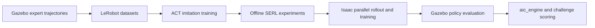

> Historical snapshot preserved on October 19, 2026. Dated running/queued statements are not current instructions. See the [current status](../../../STATUS.md) and [single future-work plan](../../../FUTURE_WORK.md).

> **October 18 score target achieved:** **290.19/300**, all three public-sample insertions pass independent depth/lateral/orientation checks; all used-stage p95 inference is below300ms. The analyze/repair/evaluate loop stops after18 completed full samples. V56 preserves three quiet SCcontext frames while sharing initial grasp observations, and seats1.5s above the public1s requirement. Rule transport and explicit RGB/public-state insertion use unchanged perception weights; no learned BCactor or RLactions. Failures and unqualified fits are preserved. This is one selected public-sample pass, with small SCdepth margin and unresolved unusual-SFP-grasp coverage; final scenes stay sealed. Earlier sections are historical. [Results, commands and videos](../../../experiments/2026-10-18-five-repair-cycles.md).

## October 18: gated close-up pose update and SC insertion result

V34 passes **4/4 matched SC development cases** (zero/five obstacle cards, both ports), followed by a passing SC round in the unchanged public sample: **15.510 mm depth, 0.141 mm lateral error, 0.469° orientation**, toolkit completion, no harm. Five fresh agreeing images support one bounded plug-pose update at 25 mm; the port frame stays fixed. Tighter lateral centering and stronger lateral tracking are also needed. All used-stage p95 timings pass; these are explicit RGB/public-state control results, not BC or RL.

The complete sample is **170.57/300, 2/3 strict** because SFP trial 2 has a 3.53° biased grasp estimate before contact. Its actual roll exceeds the original SFP training range; close-up predictions remain wrong. Repeats stop, and the next targeted repair is SFP orientation coverage rather than a stiffness-only change. No new training or collection is running. The SC model's original 1.026° qualification failure remains explicit; four successful development cases do not establish general reliability. Final scenes remain sealed.

[Detailed evidence, commands, images and next repair](../../../experiments/2026-10-18-sc-explicit-controller-continuation.md).

> **October18 live milestone:** the discrete25mmRGBheld-plug pose update passes one failedSCdevelopment start and then **3/3strict insertions** in the unchanged public three-trial sample(257.36/300). A matched controller without the update failsSC. One local recovery occurs in the development success; this is **not evidence of hierarchical superiority or newRL**. Public-sample timing/guard repairs continue with failures preserved; model original subgroup1.026°stillfails1°. [Evidence and limits](../../../experiments/2026-10-18-sc-explicit-controller-continuation.md#first-live25mm-update-full-sc-physical-insertion).

> **October 17 current pipeline:** rule-based SC/SFP transport → requested-port coarse/native-image refinement and visual acquisition → explicit visual/proprioceptive approach to about **25 mm** → shared full-connector-pose BC insertion actor. Frozen sample-derived transport/handoff: **119/124** (SC22/24, SFP97/100); separate exposed released scenes **2/6**. Four-rollout insertion diagnostic: **SFP1/2, SC0/2**; subsequent complete sample **165.42/300 points but0/3strict insertions**. No recovery or newRL in either test. The actor no longer owns the entire150mm approach in this diagnostic. See [milestones and remaining gaps](status_full_history.md#major-milestones--transport-handoff-and-insertion-october-17). Earlier dated running/queued statements are historical; step5 remains open.

<!-- evaluation-source-policy:2026-10-16 -->
## Development source correction — October 16

**Use the pre-deadline `sample_config.yaml` and task specification to develop routes, data and thresholds.** The separate `eval_config.yaml` was released after qualification and must not guide repairs. Its exact scenes **and derived stress scenes** are excluded from development. Existing frozen evaluation may finish as descriptive evidence; do not use it for training or tuning, and do not call the already inspected scenes unseen final tests. Audit earlier official-anchor data/model lineage before claiming this protocol is met. See [the evaluation protocol](evaluation_protocol_full_history.md), which supersedes earlier “work backwards from official settings” recommendations. Pinned public sources are under `configs/evaluation_protocol/qualification_public_predeadline/`. No new training is running.
<!-- /evaluation-source-policy:2026-10-16 -->

# Working on the hybrid training branch

<!-- current-continuation:start -->
## Current approved continuation — October 16

Rule transport brings either SC or SFP to a visual acquisition hold about 150 mm before the opening. A fresh requested-port pose and RGB-derived plug offset then initialize **one shared learned actor for the entire 150 mm approach and insertion**. Large hierarchical retreats return along measured poses to that acquisition hold and require fresh perception. The old 30 mm controller is historical.

**Training is running:** matched ImageNet versus visual-only transport initialization, same 13.725M full-target transformer, 30,000-update budget per arm. The fresh arm is active; the warm arm follows automatically. Actor data contain **67,039 examples from 500 usable source episodes / 377 physical reset configurations**: SC 102/30 train/validation episodes, SFP 319/49. All wider-source admission and estimated-frame audits passed. Predictions are complete recorded command targets in the visually estimated port frame, with causal robot/pose history and no privileged geometry input. Training error is not autonomous insertion success.

**Mandatory refiner retraining is complete**, including SC and SFP: 72,857 native RGB triplets from 497 original source episodes, followed by a targeted 20-episode SFP acquisition extension. Both base and repair reached validation plateaus. The strict repaired SFP offline component gate passes with the 0.95 projection threshold; this projection flag is not calibrated confidence or certified physical visibility.

**Launcher audit correction:** several newer host environment settings were not forwarded into Docker. The recent SFP live10 result remains 10/10 correct acquisitions, but actually used projection threshold **0.90**, not the intended 0.95. The active SC broad60 uses the **new repaired native refiner**, not the separately specified older SC checkpoint. Preserve these results under their actual configuration; they do not certify the intended family bundle. Let the frozen SC job finish. A separate corrected launcher records the effective container environment and forwards these settings for subsequent matched tests. The original launcher/source hashes remain intact during active evaluation.

The hierarchical runtime is implemented, including retained pre-return RGB/state, coherent lateral supervisor retries, measured route retreat and reacquisition. **28 focused contract/recovery checks pass; live actor/recovery validation is still pending.** Supervisor exploration is not RL. No new SAC/SERL, reward model, imagination or reserved-final evaluation has run. Keep final scenes sealed and at most four project GPUs including untouched legacy GPU0.

Next: finish matched BC fits and current frozen SC acquisition evaluation; verify corrected runtime settings; run fresh autonomous full-depth development rollouts, diagnose failures, then compare no/local/hierarchical recovery with identical actors and scenes. Advance to RL only after the supervised insertion gate.

See [execution record](../../../experiments/2026-10-15-rule-perception-hierarchical-execution.md) and artifact `state.json` for exact commands, failures, comparisons and paths.

**Additional SC coverage repair:** the29 existing rail-expansion episodes added4,526 RGB-proposed native crops (22/7 complete train/validation episodes) after label/split/visual QA. The joint SC+SFP repair reached a validation plateau at4,000updates. It passes9/9 previously rejected SC probes versus0/9 for both baselines, and improves new-rail accepted components166→211. Overall accepted components3722→3711 is a small regression; zero wrong/absent accepts remain. The original strict gate failure is preserved. A separately documented20-scene live diagnostic is running; the new checkpoint is **not promoted**. Black-gripper-only crops explain some large pixel-error tails and are not evidence of visible targets. Active frozen models/scenes remain unchanged.

<!-- current-continuation:end -->

## October 15 autonomous continuation: current evidence

### October 16: acquisition repair and actor-data readiness

**No new insertion BC or RL checkpoint has been trained yet.** Mandatory SC/SFP native port refiner retraining is complete to plateau. The approved learned actor still owns the entire 150 mm approach, with starts buffered to 180 mm. Large retreats must return to a measured acquisition checkpoint and obtain fresh port/grasp locks.

- **SC:** the old checker run stopped under its failure rule at 36 qualified / 41 completed of 60 planned, zero wrong ports/harm. Its code is archived with all eight frozen source hashes verified. The new single-request native-five pipeline, bounded 140 mm visual correction and measured hold gate achieved **7/7 correct acquisitions**, opening errors 0.077–0.363 mm and zero wrong/harm. All global inference p95 values are below 128 ms; one perception-active subset is 306.8 ms. Thus its stricter latency gate is **6/7, still open**. A same-scene diagnostic separates Gazebo rendering from policy inference while respecting four project GPUs. Models/scenes are unchanged. A single-point 64 px relaxation remains rejected because it accepted an absent target; the replacement five-landmark geometry rejects that case.
- **SFP coarse:** full-data recorded-image performance improved substantially, but the unchanged live six-case gate remains 3/6. Existing image history did not repair the three failed traces. A bounded twenty-reset acquisition-state repair is collecting ten training / ten validation configurations across 1–5 cards, both ports and all requested card codes, then fitting source-balanced current/history heads while retaining the full old corpus. The first two all-camera label overlays were inspected. It predicts projected-in-frame status, not certified physical visibility or learned confidence. Require at least 9/10 fresh correct acquisitions and zero wrong/harm before promotion; otherwise change the representation instead of routine recollection.
- **Grasp estimate:** a separate native SFP plug-offset model plateaued after 15,000 updates on 6,115 triplets from 307/47 train/validation sources. Across all phases its position p95 is 0.505 mm, failing the 0.4 mm gate; worst images hide the plug inside the port. In the actual runtime acquisition scope—after a causal visual port lock, with public measured TCP at least 120 mm before the opening—position p95 is **0.150 mm on 272 observations / 39 held-out episodes / 31 resets**. Translation is approved only for that scope and is locked before insertion. Orientation remains diagnostic and is not an actor input. Do not update this estimate from an inserted, hidden plug.
- **BC data:** 454 qualified original expert sources now have causal RGB port locks. Requiring a legal three-observation grasp lock leaves **432 sources / 51,667 rows**: SC 80/20 train/validation episodes and SFP 293/39. The other 22 successful SFP recordings are preserved, not called bad experts; they lack an approved early free-grasp lock. Earlier rows are never backfilled. Original data remain untouched, with a separate exact actor-pixel cache on NAS.
- **Wider demonstrations:** SC first-thirty admission passed: 22/30 physically qualified episodes, from ten original training reset configurations. All three SFP pilots at 90/150/180 mm, including lateral/8-degree offsets, fully inserted at 46.776 mm depth and 0.247–0.382 mm lateral error without scored harm. These are privileged teachers, not learned-policy successes. SFP first-thirty collection reuses those three pilots. Ten held-out wider starts per family are queued before the matched BC comparison.

Preflight fixes for the upcoming actor: complete port-frame targets for both families, exact recorded force/trajectory profile, plug-based near-port phase weighting, command-feedback masking in BOTH current and historical state, and identical native-JPEG preprocessing during training and deployment. The old 15 mm command cap would clip about 11% of SC and 27% of SFP expert chunks; the new controlled runtime must use the audited 60 mm component cap. Visual warm starts now reject silently empty/incompatible transfers; the comparison retains fresh current-data state normalization. Four real history offsets are planned, with the history-masking ablation OFF.

Rootless runs use private bridge networks and unique Gazebo partitions. Cooperative per-GPU locks serialize future rollout/training workers without interrupting active jobs. Legacy GPU0 is untouched. Current work uses GPUs3/4/5 plus that legacy allocation. Final scenes remain sealed; reward/imagination and new actor-Q training remain gated. See the [execution record](../../../experiments/2026-10-15-rule-perception-hierarchical-execution.md) for commands, failed comparisons and artifact paths.

### Latest: rail coverage, clean simulation isolation and rule pilots

**Current gates remain open.** Mandatory native refiner retraining is complete to plateau on both families, but live acquisition still needs repair before the new 150 mm insertion actor can be trained and promoted. No new insertion BC or RL actor has been trained in this continuation.

The SC coarse failure has a concrete data gap: old SC0 rail translations cover roughly −2 to +18 mm and SC1 −60 to −43 mm, whereas the released range spans −60 to +55 mm. Even the 95 failed original collections do not fill that gap. An old-layout current/history locator fit cannot establish generalization to these missing port arrangements. The bounded repair collects 29 new physical reset configurations across the rail range, both requests, 1–5 cards and absent-other-port negatives. These are perception-only recordings, not successful insertion experts. Native overlays from the first two runs were inspected and passed causal-label QA. Current/history fits use grouped splits and balance original versus expanded-layout sources; live correct-port acquisition remains the promotion gate.

The first six SFP rule-transport cases yielded **1/6 fully qualified acquisitions, zero wrong-port handoffs**. The one pass stopped about 148 mm before the port, 5.7 mm laterally off-axis, with 0.324 mm visual opening error. Several failures waited at the elevated acquisition plane without a usable visual lock; another reached the region but could not sustain the stability gate. A bounded matched pilot tests acquisition at the nominal 150 mm plane. It does not relax the visual handoff gate. This is rule transport only; no insertion actor ran.

Three repaired SC teacher starts now pass independent raw-bag terminal checks, including 150/180 mm lateral/orientation offsets. Depth is 15.57–15.59 mm, lateral error 0.15–0.46 mm, with no scored harm. A smaller reset integral gain fixes measured oscillation, and 6 mm/s axial insertion reaches full depth before the simulator completion event freezes motion. These are privileged teacher demonstrations. Restart only the bounded 30-attempt teacher gate with this controller; require at least ten independently qualified successes before expansion.

BC preparation now has **53,921 command rows from 454 qualified source episodes**, including SC and SFP. All sources have matching completion events; 4,822 later commands are excluded. Episode IDs include source-path hashes to avoid basename collisions. Four labels are actual active complete TCP targets at +50/+100/+150/+200 ms. Original data are preserved. Body-command conversion uses preceding header-time TCP and is explicitly an approximation to RT-consumption state; a four-episode audit measures p95 discrepancy of 0.07–0.12 mm. Causal RGB-derived port locks are still needed before this becomes an actor-ready dataset.

A confirmed infrastructure bug affected two later runs: concurrent host-network containers shared Zenoh port 7447 and Gazebo discovery despite separate ROS domains. Both launchers now use private bridge networks and unique Gazebo partitions. Audits found no conflict warnings in the 454 admitted original sources or the frozen 12-run SC comparison. Failed infrastructure runs remain preserved and excluded from policy evidence.

See the [execution record](../../../experiments/2026-10-15-rule-perception-hierarchical-execution.md) and artifact-root `state.json` for commands, exact counts, failures and subsequent updates. Earlier October 15 paragraphs below are intermediate history where they describe running jobs or older derivatives.

### Latest acquisition gate and BC-data preparation

The completed frozen SC comparison failed promotion: old stack **3/6** correct acquisitions, new point refiner plus association **1/6**, zero wrong accepts in either arm. No insertion actor ran. The bounded replacement of the legacy presence veto then accepted the neighboring port in **1/1** diagnosis (56.21 mm opening error): **rejected**, not a safe fix. Exact-frame replay reproduces the association scores to within 0.000041 and finds contradictory identity evidence in one camera; there is no established simple state-range or frame-conversion explanation.

A distinct crop-proposal repair is being tested: a public-request-conditioned locator chooses one SC region per camera from all three current RGB feature maps and optional 40 mm / 10 degree motion-spaced context. It omits absolute TCP coordinates and retains relative motion for history. On 83 training / 21 validation episodes, current-only and history heads both reach about 10.9 px coarse p95 with zero nearest-wrong-port views among 14,235 labeled in-frame views. Both initial fits hit an update cap; separate weight continuations seek a plateau. Fresh live diagnosis remains necessary. This predicts projected-in-frame status, not certified physical visibility.

The first BC command derivative contains 46,910 rows from qualified original sources, but 78 sources had stale archived image paths. A corrected derivative is rebuilding from the audited native-image provenance fallback. Original datasets and failed derivatives remain intact. Robot state is reconstructed as 32 dimensions from preceding controller/joint/wrench observations; actual public task codes have 10 dimensions. Four labels are the recorded active TCP targets at +50/+100/+150/+200 ms. Targets held between message publications remain genuine command supervision. Static pauses are thinned in the copy without joining actions across removed time. No future measured pose supplies an action label. Six QA panels were saved and SC/SFP examples visually inspected. Estimated port locks must still be produced before actor training.

All three initial wider SC teacher successes passed a separate raw-MCAP, pre-return audit: depth about 15.568 mm, lateral 0.082–0.117 mm, orientation about 0.012–0.013 degrees, no scored harm. A bounded 30-attempt batch covers both ports and 1–5 cards with 90/150/180 mm starts and offset perturbations. Some supervisor resets fail; these are not BC experts. Diagnose the completed batch before expansion; at least ten independently qualified successes are required. A successful teacher video is `wide_approach_pilots/wide_sc_pilot_02_event_v5/five_cameras_20fps_grid_active.mp4` under the artifact root.

The approved pipeline is rule transport → requested-port acquisition/refinement → one shared learned insertion actor owning the full 150 mm approach. Training should buffer starts to 180 mm. Large hierarchical retreats return to rule transport and require a fresh visual lock. The old 30 mm controller is a historical control, not part of this pipeline. BC and recovery comparisons remain open; no new RL has been trained in this continuation.

**Refiner retraining is now complete to a validation plateau.** The corpus contains 72,857 original RGB triplets from **497 source episodes / 633 named image streams / 422 physical resets**. These are different counts; image-stream IDs must not be counted as independent episodes. Source episodes: SC 83 train / 21 validation, SFP 340 train / 53 validation. Physical reset groups are disjoint across splits.

A matched SFP component test combines the stronger requested-port coarse locator with the new native refiner. The five-landmark pose variant accepts 356/1,120 sampled triplets with zero wrong-port accepts, versus 324 accepted by the old component. Conditional position/lateral/orientation p95 is 0.447 mm / 0.189 mm / 0.708 degrees. It fits translation and yaw using a training-only fixture normal prior; arbitrary tilted fixtures are not established. The set has 70 image-stream IDs but only 53 source episodes / 45 physical resets. These are component results, not autonomous insertion success. Preloaded-image perception p95 is 20.46 ms; complete live latency remains unverified.

A diagnostic global orientation head previously used simulator card count, which is absent from the public task. Those old results are quarantined and must not support deployment claims. Its corrected public-input control has now plateaued: SC/SFP angular p95 2.33/3.27 degrees, versus state-only 4.80/4.08 degrees. The native landmark fit above remains the more precise component candidate.

Independent geometry, official insertion score and contact/force records admit **454 source episodes** for subsequent BC preparation: SC 80 train / 20 validation, SFP 307 train / 47 validation. This is an admission index, not yet a materialized action-chunk dataset. Ownership, image-time state joins, stall cleaning and predicted-frame targets remain mandatory. Original data are untouched. Failed or shallow recordings can remain useful for perception without becoming successful BC experts.

The wider SC teacher now demonstrates full insertion from all three diagnostic starts, including a 180 mm approach and lateral/orientation offsets. The third case originally returned before the simulator contact timer completed; waiting for the teacher-only completion event fixes its official score to 75. These are privileged teacher demonstrations, not actor successes, and require independent raw-bag geometry/force checks before expansion. The first 30 wider attempts must contain at least 10 qualified full insertions before collection scales.

The frozen six-configuration/two-arm SC acquisition comparison has completed and failed its gate. The legacy-veto replacement also failed a wrong-port test; see the latest update below. No final scenes have been opened.

Artifacts and exact commands: `/home/nas/chmin/aic_archives/2026-10-15_rule_perception_hierarchical_v1/`. Detailed chronology: [execution record](../../../experiments/2026-10-15-rule-perception-hierarchical-execution.md).

**October 15 execution update:** Broad SC/SFP native refinement now improves opening-position accuracy: conditional SC lateral p95 is 0.20 mm; the stronger SFP coarse pipeline plus the new refiner improves lateral p95 from 0.82 to 0.29 mm on 70 validation recordings, with zero observed wrong-port accepts in that comparison. Training continues because the first 12,000-update fit was still improving. Coarse identity repair remains experimental: rejecting known wrong handoffs also rejects some correct ones. Wider 150/180 mm SC teacher pilots now reach full seating after measured alignment and a corrected completion condition; broader data admission is still gated. New insertion BC, deployed hierarchy and RL have not passed their gates. [Evidence and active execution](../../../experiments/2026-10-15-rule-perception-hierarchical-execution.md).

**October 14 current execution:** Supported normal-board SC rule transport and RGB handoff passed small screens. Matched corrective-data, decoder and 6-second robot-history repairs did not pass autonomous full insertion. A separately frozen observation-only approach reached **29.12 mm before the opening / 0.148 mm lateral**, then the unchanged trained actor achieved **11.07 mm insertion depth / 0.413 mm lateral / 0.94° orientation error** on one reused start. Official score 75, but the unchanged ≥14 mm physical gate failed. Logs confirm contact-triggered completion and end-effector locking; no cable snag explains this run. This is meaningful approach progress, not a promoted insertion policy. All new jobs finished; no routine collection, RL, world-model work or final-scene access. SFP local insertion, rotated SC and port-0 rail minimum remain unapproved. [Execution record](../../../experiments/2026-10-14-transport-handoff-execution.md) · [Easy explanation](../../2026-10-14-autonomous-execution-outcome.md).

**Current transport/handoff work plan (October 14):** [Learned and rule-based transport, terminal supervision, visual handoff and insertion](../../../../obsolete/docs/2026-10-19-retired-plans/TRANSPORT_HANDOFF_IMPROVEMENT_PLAN.md).

**Latest SC transport check (October 13):** The training copy already removes the known teacher holds, and the actor's 60 s history spans them. A 100 ms action-spacing actor, its denser 70 s context variant, and a separate actor intentionally fitted to <1 mm training action error improved closest port approach on six matched SC development starts, but all three still reached **0/6 approach bands and 0/6 insertions**. The intentional-fit actor also failed two training-scene rollouts. The remaining gate is closed-loop route progress, not simply more teacher pause cleanup. No checkpoint is promoted; final scenes, insertion handoff and RL stay gated. [Full comparison, videos and artifacts](../../../experiments/2026-10-13-sc-pauses-context-and-overfit.md) · [current status](status_full_history.md).

**Latest transport fit (October 12):** A route-consistent diffusion actor was retrained on 533 SFP and 83 Low Lateral Bypass SC training episodes. It improved held-out teacher-state action error, but matched autonomous Gazebo runs still reached 0/3 safe buffers for each family; the checkpoint is not promoted. [Fit, live gate and artifacts](../../../experiments/2026-10-12-route-consistent-diffusion-retrain.md) · [current status](status_full_history.md).

**Earlier route repair (October 9):** Two five-card SFP cable-side teacher routes failed the predeclared Gazebo safety/arrival gate (0/2 and 1/3). No route actor or automatic handoff was enabled. [Results, videos and next label gate](../../../experiments/2026-10-09-sfp-cable-side-route-repair.md) · [status](status_full_history.md).

**October 9 SFP route result:** A selected-port visual anchor was available at all six saved actor takeovers, but only two of three preselected privileged Gazebo routes reached the transport buffer; the five-card route stalled under high force. These are diagnostics, not autonomous transport or insertion. Route safety and actor-state labels remain the gates before training a route actor. [Detailed record and video](../../../experiments/2026-10-09-sfp-route-target-and-gazebo-gate.md) · [status](status_full_history.md).

**October 8 handoff-only check:** Four fresh two-port SC shadow routes correctly approved the requested port without contact. One nearby one-port target was missed because the close-view orientation check could not find enough board lines. A bounded saved-orientation repair had no attributable live gain and stays off; a fixed lossless native-image replay also found no memory-only improvement. For SFP, only one of six saved autonomous routes entered the stop corridor; vision recognized its two sampled visits, but transport arrival is still the limiting gate. Neither family has an automatic insertion switch from this check, and RL remains disabled. [Full handoff record, matched results and next gate](../../../experiments/2026-10-08-handoff-only-shadow-and-memory.md) · [current status](status_full_history.md).

**Actual Gazebo MoveIt video (October 8):** A one-scene, privileged SFP
planner replay after a frozen actor prefix reached the 85 mm transport
buffer without scored contact; it did not insert or pass the autonomous
gate. [Watch the five-camera recording](</home/nas/chmin/aic_archives/2026-10-08_sfp_requested_corridor_v3_with_quat/gazebo_case5_live_replan_v1/video/all_views_20fps.mp4>) ·
[read the measured result](../../../experiments/2026-10-08-sfp-requested-port-corridor-audit.md#requested-gazebo-replay-actual-robot-and-cable-motion).

**Latest SFP route-label gate (October 8):** A requested-port planner
found rigid MoveIt routes from 6/6 saved actor states, but only 3/6 cleared
the conservative full-cable screen. That screen also flags measured teacher
cable paths, so it is not a contact oracle. No new actor or autonomous
insertion was promoted; the one later Gazebo replay above is a privileged
diagnostic. [Current status](status_full_history.md) ·
[corridor audit and next bounded repair](../../../experiments/2026-10-08-sfp-requested-port-corridor-audit.md).

**October 8 planning check (latest):** MoveIt could plan a rigid arm path
from five of six saved SFP actor states to a future expert state. On two
development scenes it took a nearly straight shortcut across the expert's
longer measured detour. The cable was not checked and the target was given
privilegedly, so this does **not** provide a safe route label or an improved
actor. No new Gazebo replay followed. Independent autonomous transport is
still 0/3 safe arrivals; handoff, insertion and RL stay gated.
[Status](status_full_history.md) · [planning experiment and path plot](../../../experiments/2026-10-08-sfp-actor-state-moveit-feasibility.md).

**October 8 actor-state label pilot (latest):** A one-shot privileged
CheatCode query cannot label a route: its first interpolation command holds
the current pose. In three real five-second actor-prefix teacher takeovers,
two fully inserted but only one produced a clean 20 mm measured-path
waypoint. The fixed 2/3 gate failed, so no new actor fit or live autonomous
test followed. A different first-10-mm-net label was available in all old
takeovers, but only 4/6 held-out routes were direct enough for a simple
straight waypoint. Independent autonomous transport is still **0/3 safe arrivals**;
handoff, insertion and RL stay disabled.
[Status](status_full_history.md) · [full pilot and path plot](../../../experiments/2026-10-08-sfp-actor-recovery-label-feasibility.md).

**October 8 route-waypoint result (latest):** A model predicting a short
TCP-frame route target learned ordinary SFP teacher motion, but the proposed
command agreed with recovery motion on **0/6 saved actor boundaries**. A
distance-based target also missed its offline gate. This branch was not run
live; the last independent autonomous transport result remains **0/3 safe
arrivals for both actors**. The next bounded experiment must obtain and
verify labels at actor-visited recovery states before another actor fit.
Automatic handoff, insertion and RL remain off; final scenes sealed.
[Status](status_full_history.md) · [experiment, commands and next gate](../../../experiments/2026-10-08-sfp-short-route-waypoint-feasibility.md).

**October 8 actor restart result (latest):** The selected-port pose input was
available at only 3/6 training and 1/3 development first corrective decisions.
Training on accepted-pose rows could copy those actions without actually
using pose. In a matched full-data comparison, resetting the actor's action
head worsened late development action p95 from 2.833 to 3.694 mm and also
worsened ordinary SFP/SC. Pose removal changed either actor's actions by
under 0.05 mm p95. Do not restart the whole actor under this recipe; the next
design needs explicit route-level supervision and better pose coverage at
the first correction. No new autonomous or final scene was opened.
[Status](status_full_history.md) · [experiment and exact artifacts](../../../experiments/2026-10-08-sfp-pose-actor-training-method.md).

**Current SFP transport decision (October 7):** A frozen vision pipeline
found the requested port in 3/3 saved failed-actor routes and made zero wrong
accepts. Yet a full-action transformer trained with that estimated pose
barely used it: two matched fits missed their offline improvement gates,
including one with balanced 15-second recovery labels. The best pose-input
action-p95 gain was under 0.01%, and its action changed only 0.032 mm p95
when the accepted pose was removed. The last independent autonomous test
remains **0/3 safe transport arrivals for both actors**. Stop this simple
pose-input BC architecture; design an explicit route-error/progress control
objective before another policy fit. Automatic handoff, insertion and RL
remain disabled; final scenes sealed. [Status](status_full_history.md) ·
[complete experiment and images](../../../experiments/2026-10-07-sfp-early-branch-support.md).

**Earlier SFP transport result (October 7):** On three truly unseen 2/3/5-card
Gazebo starts, the action-only actor with actor-prefix corrective supervision
and its matched control each reached **0/3** safe transport arrivals and
**0/3** insertions. A separate frozen visual route probe could read useful
early branch information, but adding it to the full-action actor did not pass
the live gate. Privileged teachers recovered safely from 3/3 late actor
states; a final balanced late-correction fit then improved held-out action
p95 only **3.086→2.978 mm**, below its 10% gate. Stop scaling this same BC
recipe. Next check the frozen selected-port perception model on saved
off-route actor views before testing explicit route feedback. Automatic
handoff, insertion and RL remain disabled; final scenes are sealed.
[Current status](status_full_history.md) · [experiment, commands and artifacts](../../../experiments/2026-10-07-sfp-early-branch-support.md).

**October 7 board-origin verdict:** A fixed visible-board-corner alternative also failed. Collision-box corners were not exact visual landmarks; actual mesh screws helped label alignment but one screw was regularly hidden by cards. Even an oracle screw position plus train-only board layout gave 22.62 mm median requested-port error and three wrong-opening nearest neighbors (true yaw still 15.02 mm/two wrong). Board context may aid card order, but cannot replace task-selected local port perception. Handoff stays off; the independent complete-public-state review is pending. [Full audit and images](../../../experiments/2026-10-07-sfp-visible-board-origin-audit.md).

**October 7 board data-scale check:** More existing projected-endpoint data from 20→40→70 complete training groups reduced held-out p95 only **34.58→34.67→32.17 px** and produced **1/10→0/10→3/10** accurate early board references, far short of the gate. A 30-panel single-reviewer image check found no confidently unique visible numbered endpoint; independent review is pending. Stop same-label scale-up and seek a visually grounded board origin or safe observation view. [Full result and plots](../../../experiments/2026-10-07-sfp-rail-data-scale-and-visibility.md).

**October 7 board-memory check:** Combining frozen RGB board-endpoint estimates over 3 s reached **1/10** early accurate SFP scenes; a bounded original-image crop refiner raised this to **3/10**, still below the fixed 9/10 gate. Refined endpoint error remained 9.92 px median / 32.17 px p95. Privileged accurate-pixel controls reached 10/10, so the blocker is a reliably visible numbered board landmark, not the camera geometry alone. The branch stopped before handoff, actor training or new scenes. Independent public-observation review and a distinct observable-origin hypothesis are needed; SFP transport also remains 0/3 safe arrivals. [Record and diagnostic image](../../../experiments/2026-10-07-sfp-temporal-board-reference.md).

**October 7 redesign result:** The new structural SFP target-cue probes did not pass handoff: candidate-set upper bound 4/10 early, local pixel cue 1/10 early accepted, and single-3D cue five wrong accepted ports with 39.75 mm accepted p95 and poor uncertainty calibration. A privileged target cue on frozen teacher-state transport features improved early action p95 only 2.9%; it was offline and never deployable. The observation-complete 30-panel review remains unscored independently. Automatic handoff and insertion remain disabled. [Evidence, commands and next decision](../../../experiments/2026-10-07-sfp-slot-feature-port-cue.md).

**October 7 gate:** SFP transport still misses safe arrivals (0/3), and selected-port identity is not ready for autonomous handoff (3/10 early on the hard ten-request check). A corrected 30-panel review packet contains public measured TCP state as well as RGB/history and task code; it awaits independent annotation. The earlier 11 RGB-only abstentions omitted this state. A fixed 320 px crop improved two-camera neighbor exclusion from 3/10 to 6/10 development groups but missed the 9/10 gate, so no new fit followed. The nominal global-coordinate cue had already failed. [Experiment and artifacts](../../../experiments/2026-10-07-sfp-observation-complete-review-and-tight-crop.md).

**October 6 continuation:** The guarded +10° SFP wrist-view pilot did not establish numbered-card identity and missed its 5 mm held-position gate by 1.38 mm, despite no force/contact event. It stopped after one reused nonfinal scene; two earlier command-frame bugs and all traces are preserved. A second independent review of the frozen 40 RGB panels remains outstanding. Spatial transport fitting stays gated by hard-scene target identity; no handoff, insertion or RL was enabled. [Current status](status_full_history.md) · [view record and image](../../../experiments/2026-10-06-sfp-board-tilt-view.md).

**October 6 latest:** The requested-card visual gate is still open. Forty original-RGB SFP panels were frozen; 11 blind reviews were all uncertain about the absolute requested card/opening. A guarded opposite-side view returned safely on one reused scene but made the row harder to see, so it failed the predeclared identity gate. No model or handoff was promoted. Transport also remains 0/3 at safe buffered arrival; insertion and RL are disabled. [Status](status_full_history.md) · [experiment, images and next hypothesis](../../../experiments/2026-10-06-sfp-requested-card-identifiability.md).

**October 6 latest:** A local head predicting the selected card anchor and both ports reached only 2/10 early development groups under its geometry guard; a simpler rail/TCP port-region prior missed by 111 px p95. Both failed their fixed gates and were stopped. The single-point crop detector remains the offline reference, with variable early coverage across scene sets. The next prerequisite is checking whether the requested card is visually identifiable in saved original-RGB views, particularly neighbor-card confusions and occlusions, before fitting another model. Automatic handoff and RL remain off. [Status](status_full_history.md) · [experiment](../../../experiments/2026-10-06-sfp-local-card-pair-repair.md).

**October 6 fresh SFP camera test:** Jointly matching five possible opening peaks across three cameras looked good on development but failed ten new nonfinal reset groups: eight wrong-port accepts persisted even with two-inspection confirmation. The previous single-point crop model was safer on those new images (zero wrong, 10/10 early), although it was early on only 6/10 of the older additional scene groups. Reprojection and persistence cannot determine the requested numbered card when a neighboring card looks similar. Keep the automatic transport-to-insertion switch off; next address explicit visual card identity. [Current status](status_full_history.md) · [full comparison and failure images](../../../experiments/2026-10-06-sfp-joint-camera-candidates.md).

**October 6 update:** The slot-local RGB board head now chooses a requested-card crop in original camera images. Its selected opening was projected inside at least two 480 px crops early on 10/10 development and 10/10 extra nonfinal scene groups. A 2,000-update request-conditioned crop refiner improved accepted 3D p95 to 1.80 mm and removed wrong-port accepts on the extra ten scenes, but still acquired an early cross-camera-consistent pose on only 6/10, below the 9/10 gate. The remaining visual error is often a neighboring-port choice in one camera. Automatic handoff, PoseInsert and RL remain disabled; transport itself still fails its safe-arrival gate. [Current status](status_full_history.md) · [full experiment](../../../experiments/2026-10-06-sfp-slot-conditioned-crop-feasibility.md).

**Latest SFP perception result, October 5:** A three-camera **slot-local board head** now reads image features around five rail positions that it predicts from RGB. Against the older whole-image head, exact occupied-slot maps improved from 5/10 to **10/10** on grouped development and from 5/10 to **10/10** on ten further disjoint nonfinal teacher-route scenes; three saved sparse autonomous routes stayed 3/3. It had zero confident false occupied rails in these sets and 83.8 ms standalone three-camera p95. This answers *which rails are occupied*, not *which port is the requested opening*. A strict causal 3D rail-to-port check still had only 1/10 early correct scene groups because the endpoint predictions disagreed across cameras; automatic handoff, PoseInsert and RL remain off. [Status](status_full_history.md) · [experiment, artifacts and next repair](../../../experiments/2026-10-05-sfp-slot-local-occupancy-ablation.md) · [handoff plan](../../../../obsolete/docs/2026-10-19-retired-plans/SELECTED_PORT_HANDOFF_PLAN.md).

**Spatial transport prerequisite, October 5:** On three saved one/two-card autonomous routes, frozen original-RGB locators each found the requested port early on 3/3, but the actor still reached 0/3 safe buffered arrivals. This limited success does not override the failed ten-request/five-card identity gate, so no spatial actor was trained or attached. The [new audit](../../../experiments/2026-10-05-spatial-transport-prerequisite.md) gives the exact replay, artifacts and next slot-identity repair.

**Current gate (October 5):** Added 29 fully inserting SFP alternate-target teacher episodes across one to five cards, rebuilt 326 training episodes with 35 same-board request pairs, and trained a corrected action-only transport actor. Held-out first-action error improved, but the actor still reached the requested safe buffered region on **0/3 new autonomous starts**. A larger-data learned handoff head remained timely on only **2/10** teacher episodes; bounded task-selected final-head repairs did not solve the requested-target route decision. Keep the transport-to-refiner switch, PoseInsert and RL disabled. The next targeted hypothesis is observation-selected spatial port/card context for the actor, using the existing immutable data before collecting more generic trajectories. See [status](status_full_history.md), [full experiment](../../../experiments/2026-10-05-transport-route-handoff-continuation.md), and [machine summary](../../../experiments/2026-10-05-transport-route-handoff-continuation.summary.json).

**Earlier October 5 gate:** SFP autonomous transport and selected-port coarse identity remain open. A same-observation request-swap audit found weak task-code use; a bounded transport-head repair and the frozen crop model failed their predeclared gates. Six same-board alternate-request teacher controls ran after a mistaken quota-field check was fixed; five fully inserted. The rootless UID key quota is 1024. A matched fit on the successful pairs improved held-out first-target error only 9.3% against a 20% gate and did not run live. See [status](status_full_history.md), the [experiment record](../../../experiments/2026-10-05-transport-identity-task-code-audit.md), and the [handoff plan](../../../../obsolete/docs/2026-10-19-retired-plans/SELECTED_PORT_HANDOFF_PLAN.md).

**October 5 status:** The shared coarse history and original-image crop experiments remain below the safe target-identity gate: the best direct-row plus rail-fallback crop refit accepted 299/391 proposals on an already inspected ten-scene SFP diagnostic, with one wrong port and 7/10 early episodes. A separate base-frame coordinate replay showed that nominal port locations can flag a general neighborhood on teacher routes but would have produced unsafe stops on saved autonomous routes; exact target TF is ground-truth information during evaluation. Transport, visual identity and safe handoff still need repair. [Current status](status_full_history.md) · [coarse record](../../../experiments/2026-10-04-coarse-shared-history-execution.md) · [coordinate audit](../../../experiments/2026-10-05-global-coordinate-arrival-proxy.md).

**Latest execution result, October 4:** Six targeted five-card Gazebo teacher episodes all inserted and expanded the grouped SFP coarse training set to 66 episodes. Rebuilding observation-only proposals from all SFP channels and training a refiner on native-image crops improved an already inspected ten-scene diagnostic to 244/370 accepted proposals, one wrong-port acceptance, and 6/10 early target acquisitions. This remains below the zero-wrong and 9/10 early gate. A matched wrong-neighbor repair is running; true visual-visibility and safe-stop labels are still absent, so automatic handoff and RL remain disabled. [Current execution record](../../../experiments/2026-10-04-coarse-shared-history-execution.md).

**Current pipeline plan (October 4):** Transport approaches the requested port; a shared coarse three-camera history model proposes **current-image** crops and decides whether to pause for precise inspection; a separate refiner estimates the one requested pose; an insertion actor acts in that estimated port frame. The old late camera-check role is part of the coarse pause/accept head. Distance-sampled camera memory is being developed at a provisional 30 mm/up to twelve views. The [execution plan](../../../experiments/2026-10-04-coarse-shared-history-execution.md) specifies data, gates and preserved final scenes. The handoff and RL are still disabled because SFP autonomous transport and safe target identity have not passed their gates. See [current status](status_full_history.md).

**SFP board-slot audit (October 4):** In ten saved nonfinal teacher camera pairs, unmarked original RGB supported a confident full five-slot map in only 4/10, all fully occupied rows. All five sparse rows remained uncertain because card rank does not identify absolute slot number and board ends were often clipped. The predeclared board-reference gate failed; no new perception model was trained. [Blind images and decision](../../../experiments/2026-10-04-sfp-board-slot-reference.md).

**Wider SFP observation gate (October 4):** A guarded original-RGB view detour exposed the full four-card row in the pilot, but did not establish which visible face corresponds to the requested numbered slot; empty slots make counting installed cards unreliable. Three of four reused nonfinal view routes returned safely; one aborted at its measured-pose tolerance. The predeclared visual identity/safety gate failed. No new model, handoff, autonomous insertion or RL followed. [Images and result](../../../experiments/2026-10-04-sfp-wide-observation-gate.md).

**Requested-port camera-history test (October 4):** A new coarse model uses the requested SFP port code plus synchronized current/earlier views from all three cameras, and predicts just that port's candidate crop. Several bounded variants and targeted five-card data failed the safe identity gate: the final geometry-checked variant acquired 3/10 inspected stress episodes early, no better than the older selected-only head. The available in-frame labels cannot certify actual visibility, and some first views show only part of the card row. No automatic crop-to-refiner handoff or insertion was enabled. [Full comparison and next upstream gate](../../../experiments/2026-10-04-requested-history-crop.md).

**SFP coarse-output and audit correction (October 4):** The joint coarse network predicts 12 possible port channels per camera: two SC ports and two ports on each of five possible SFP card slots. It does not currently use camera history. An earlier offline SFP crop audit used simulator presence labels to filter candidates; the corrected replay uses all ten SFP channels and still fails requested-port identity (47 wrong accepts in the four-head union). See [corrected experiment record](../../../experiments/2026-10-04-sfp-fresh-anchor-shadow.md#corrected-all-channel-crop-replay-october-4).

**Latest SFP view diagnostic (October 4):** A ±15 mm side-on wrist-camera move was feasible in four reused development scenes with light cable contact, but the frozen perception models did not acquire the hard card-2/port-0 target. Three requests were already accepted at the baseline view. No new identity model, autonomous handoff, insertion or RL was promoted. Inspect the [raw view grids and matched scores](../../../experiments/2026-10-04-sfp-side-view-diagnostic.md) or the [current status](status_full_history.md).

**Latest SFP identity result (October 4):** Fresh ten-scene testing revealed coherent wrong-port accepts even when the requested opening was inside observation-selected crops. A full-image slot/paired-port model and a safe side-on camera shift did not repair acquisition. A new causal replay used a trusted selected-port estimate as an anchor: it recovered 53 later accepted frames but **no new episodes**, leaving early coverage at 3/10. Some raw views lack the full card row; in a five-card scene where it is visible, the frozen model still fails. No automatic handoff, insertion or RL is enabled. Next establish visual slot identity and true identifiability before one bounded full-view plus local-crop repair. [Context audit](../../../experiments/2026-10-04-sfp-context-sufficiency-audit.md), [current status](status_full_history.md).

**Earlier SFP coarse-anchor continuation (October 4):** A task-selected 480 px crop from the original camera images improved offline requested-port acquisition. A four-model frozen comparison reached 9/10 requests by three seconds and 10/10 eventually on reused development starts, with zero accepted wrong ports. Fresh ten-scene testing subsequently failed identity with 47 accepted wrong model predictions. The rootless Docker key quota was raised to 1024, allowing the sequential scene captures. No automatic SFP handoff, insertion, or RL was enabled. See the [earlier crop experiment](../../../experiments/2026-10-04-sfp-observed-rail-crop.md), [fresh failure](../../../experiments/2026-10-04-sfp-fresh-anchor-shadow.md), and [current status](status_full_history.md).

**Latest SC handoff result (October 3):** An image-based held-state rotation corrected port-0 TCP orientation in two shadow Gazebo runs, but the existing identity head then rejected the real port. The head responds strongly to TCP quaternion even when the RGB image is held fixed. A refit without quaternion input rescued those images but falsely accepted an absent port in 11/100 triplets on a new reset. No automatic insertion or RL was enabled. See the [orientation and identity record](../../../experiments/2026-10-03-sc-orientation-identity-repair.md), [status](status_full_history.md), and [handoff plan](../../../../obsolete/docs/2026-10-19-retired-plans/SELECTED_PORT_HANDOFF_PLAN.md).

**Latest SC handoff decision (October 3):** A new original-RGB selected-port crop classifier failed on four independently frozen one-port resets. The existing spatial identity check recalled 134/135 projected selected-port triplets with no absent-port all-view accept; the crop check recalled 102/135 and accepted 25/144 absent-port requests. It also failed to make the known port-0 handoff safe because the verifier measured 6.71° wrong TCP posture. The experimental crop stays off, and automatic insertion/RL remain gated. See the [crop experiment](../../../experiments/2026-10-03-sc-original-rgb-crop-identity.md), [status](status_full_history.md), and [handoff plan](../../../../obsolete/docs/2026-10-19-retired-plans/SELECTED_PORT_HANDOFF_PLAN.md).

**Latest live handoff check (October 3):** A frozen SC transport runner now pauses at the requested port, inspects fresh three-camera RGB, rejects uncertain geometry or wrong posture, and can correct orientation from observed board edges. Four new development starts across both ports and varied cards reached accepted **transport-only** shadow handoffs; matched direct-RGB repeats did so again with verifier p95 176 ms and post-run opening error 0.10–0.25 mm. No insertion occurred. An opt-in SFP head check falsely paused 162 mm from its requested opening; the SC-trained head remains disabled for SFP. Hard occlusion, coherent wrong-port cases, an SFP-specific arrival rule, and complete attached-actor latency remain open, so the insertion switch and RL stay disabled. Start with the [live record](../../../experiments/2026-10-03-live-sc-shadow-handoff.md), [status](status_full_history.md), and [handoff plan](../../../../obsolete/docs/2026-10-19-retired-plans/SELECTED_PORT_HANDOFF_PLAN.md).

**Latest handoff check (October 3):** The frozen SC board-rail orientation method resolved the sampled one-port orientation error, and a cross-view SFP candidate rule eliminated the two wrong accepted constructed triplets while retaining most correct ones. These are offline component improvements. The automatic switch is still disabled pending reviewed visibility, safe shadow handoff, and complete live latency; insertion and RL remain gated. Start with the [geometric repair record](../../../experiments/2026-10-03-geometric-handoff-repair.md), [current status](status_full_history.md), and [handoff plan](../../../../obsolete/docs/2026-10-19-retired-plans/SELECTED_PORT_HANDOFF_PLAN.md).

**Current handoff decision (October 3):** The original-resolution requested-port crop test and one targeted repair are complete. SC orientation and SFP neighboring-port identity improved, but both still fail the predeclared handoff gate. Automatic switching, insertion actor promotion, RL and final-scene evaluation remain closed. Start with the [native-crop decision](../../../experiments/2026-10-03-native-crop-handoff-gate.md), [current status](status_full_history.md), and [deployment plan](../../../../obsolete/docs/2026-10-19-retired-plans/SELECTED_PORT_HANDOFF_PLAN.md).

**Current gate (October 3):** The frozen transport-to-insertion handoff failed a known SC wrong-posture stop. A bounded one-port orientation repair helped but still missed the independent 3° requirement; the switch remains disabled. Start with [the fixed-gate record](../../../experiments/2026-10-03-frozen-handoff-gate-and-orientation-repair.md), [status](status_full_history.md), and [the handoff plan](../../../../obsolete/docs/2026-10-19-retired-plans/SELECTED_PORT_HANDOFF_PLAN.md).

**Latest handoff result (October 3):** SFP task-conditioned candidate matching improved a small frozen wrong-port replay. SC wrong-posture acceptance, grouped SFP false accepts, visibility review, and complete live latency keep the automatic switch gated. Start with [the experiment record](../../../experiments/2026-10-03-selected-port-correspondence-continuation.md), then [current status](status_full_history.md) and [the deployment plan](../../../../obsolete/docs/2026-10-19-retired-plans/SELECTED_PORT_HANDOFF_PLAN.md).

**October 3 SC identity improvement:** A spatial model conditioned on the requested SC port rejected **109/109** absent-port requests across four new development resets when **all three cameras** agreed, while accepting 96/100 real openings projected into all views. A matched pooled head failed badly (32/109 false accepts). This is a provisional identity subtest; projected-in-frame is not the same as visually identifiable, and the SC hard-occlusion, SFP wrong-port, full live latency, handoff and insertion gates remain open. [Result and artifacts](../../../experiments/2026-10-02-sc-absent-port-identity.md#spatial-selected-port-continuation-on-new-reset-groups).

**October 2 identity stop:** A matched SC request-swap test exposed a missing-port failure: the current visual rule accepted 16/16 requests for an absent SC port by locking onto the real neighboring port, despite three-camera agreement. The 104 original SC projection episodes contained both ports; two small supervised repairs still failed on different one-port reset groups. Keep transport-to-insertion handoff disabled and use [the identity diagnostic and next gate](../../../experiments/2026-10-02-sc-absent-port-identity.md) before policy integration.

**October 2 SC agreement diagnostic:** The RGB-selected native crop pipeline passed a narrow clear-view position check on three new SC development resets. A three-camera reprojection check rejected 20 provisionally hidden examples in a small older batch, but this is not a validated visibility or handoff gate: hard occlusion, wrong-port identity, SFP, full live latency and autonomous insertion remain open. [Evidence and stop rule](../../../experiments/2026-10-02-selected-port-handoff-execution.md#bounded-three-camera-disagreement-diagnostic).

**October 2 selected-port continuation:** On three new SC development resets covering both requested ports, the RGB-selected native crop refiner reached **0.230/0.175/0.149 mm lateral p95** in reviewed clear approach views. This passes the narrow clear-view position subtest. A 20-scene-group RGB review still leaves plug-covered visibility uncertain, SFP visibility unlabelled, and the autonomous transport-to-insertion switch untested. [Detailed continuation and images](../../../experiments/2026-10-02-selected-port-handoff-execution.md#continuation-native-sc-crop-second-target-and-grouped-visibility-review).

**October 2 SC locator replication:** A small decoder repair removed a gross wrong-object detection on two new SC port-0 development layouts, but its three-view lateral error remains **1.43/1.26 mm p95**, above the insertion corridor. Corrected original-RGB visibility review images are saved; a provisional three-scene SC triage found four false-visible calls among 20 hidden cases. No certified SFP/SC visibility training set or automatic handoff is validated yet. [Evidence, overlay and next gate](../../../experiments/2026-10-02-selected-port-handoff-execution.md#independent-five-card-replication-and-3d-consequence).

**October 2 handoff execution:** The first arrival-head refit failed on the
frozen SC routes (1 safe / 6 false pauses), and a fresh SFP auxiliary-depth
repeat produced flat-gray images and invalid depth after motion. Both are
preserved as failed diagnostics; no new head or visibility labeler was
promoted. Precise selected-port perception and automatic insertion handoff
remain gated. See the [execution record](../../../experiments/2026-10-02-selected-port-handoff-execution.md)
and [revised active plan](../../../../obsolete/docs/2026-10-19-retired-plans/SELECTED_PORT_HANDOFF_PLAN.md).

**Current plan (October 2):** Transport uses the task code and camera/motion
history to approach the requested port, then proposes **pause and inspect**.
Precise perception runs near the destination and predicts **one requested
port's pose plus per-camera identifiable visibility**, or rejects the request.
It does not need to report precise poses for every port, and a learned
confidence output is deferred. A verified safe waiting pose permits the
separate port-relative insertion actor to start. The current all-candidate
locator, experimental stop rules, and local actor have **not** passed this
autonomous end-to-end handoff. [Read the active design, training labels,
runtime sequence, and ordered gates](SELECTED_PORT_HANDOFF_PLAN.md).

**October 2 transport stop check:** On seven frozen SC development paths,
visual stopping yielded five valid handoffs and one unsafe false handoff;
the transport-only head yielded two valid and two false handoffs while
missing three arrivals. A small live pair diverged in route, so general
promotion is withheld. SFP visual stopping remains disabled after a
wrong-port replay. [Stopping comparison, videos and decision](../../../experiments/2026-10-02-transport-stop-comparison.md).

**October 2 newest decision:** A stage-preserving expert recovered ten
five-card SFP actor prefixes, yielding 1,392 causal correction rows. The
matched BC continuation improved held-out lateral target p95 only 1.82 to
1.72 mm and still retreated on all nine frozen aligned live observations.
The predeclared insertion-policy gate failed; these teacher-assisted
insertions are not autonomous successes. See [status](status_full_history.md) and
[the controlled comparison](../../../experiments/2026-10-02-two-family-perception-local-bc.md#bounded-on-policy-correction-comparison-declared-before-training).

**October 2 latest gate:** Paired-port RGB estimation and immediate handoff
were accurate on one five-card SFP reset, but the BC insertion actor still
missed by about 20 mm lateral. A matched 600-update coordinate-frame repair
did not pass the action gate. See [status](status_full_history.md) and the
[latest experiment](../../../experiments/2026-10-02-two-family-perception-local-bc.md#october-2-immediate-lock-failure-and-matched-actor-frame-repair).

**October 2 earlier branch:** SFP selected-port perception has a two-crop native-resolution cascade and a five-observation static lock, tested on ten grouped development scenes. A 29-scene full-success SFP expert set supplies alternate-target insertion BC; SC on-policy correction scored zero insertion in a same-scene live trial. Native SFP and SC advancing-phase actor continuations completed without a full-insertion promotion; the later paired-frame and axial-action diagnostics above supersede their action decision. No autonomous full insertion or RL promotion is claimed. [Experiment, videos, artifacts, and limits](../../../experiments/2026-10-02-two-family-perception-local-bc.md#october-2-continuation-complete-sfp-cascade-and-insertion-diagnosis).

**October 2 current result:** Visual transport can reach and now stop at the measured SC pre-insertion pose, but its early route still varies. A smaller command cap helped one layout and hurt another, so it is not the fix. A base-frame phase-waypoint probe missed its held-out 20 mm gate (best predicted-stage p95 22.36 mm), so it was not deployed. The next bounded test is whether the late-route card-row landmarks can be located reliably from the existing camera views. No reliable full insertion or RL result is claimed. [Details and artifacts](../../../experiments/2026-10-01-transport-reliability-continuation.md).

**October 1 transport reliability continuation:** A long-history shared actor, explicit two-port SC visual locator, and late visual transport controller now reach the measured pre-insertion pose on several held-out one/three/five-card development starts. A fast path ran at 176–190 ms p95, but one five-card repeat still left the route by 93.6 mm p95 and missed orientation. A bounded optional height guard helped an exercised low-route repeat, but reliable transport, insertion and RL remain open; reserved final scenes stay sealed. [Full experiment, videos and next gate](../../../experiments/2026-10-01-transport-reliability-continuation.md).

**October 1 latest:** A new controlled transport comparison tested 60 s observation history, route representation, a diffusion transformer, a live SFP check, and separate SFP/SC heads. Long history reached 8 mm from the teacher SFP pre-insertion standoff on one live development scene but still missed orientation and did not insert; it made an SC five-card start worse. Route, diffusion, and task-specific heads did not pass their supervised gates. [Full experiment, recordings, and decision](../../../experiments/2026-10-01-transport-five-way-comparison.md). Step 5, local insertion handoff, RL, and final scenes remain open/gated.

**October 1 earlier supervised sequence:** One shared temporal transport actor first, then a task-conditioned selected-port perception model, then a separate port-relative insertion actor with a stable observation-only handoff. The first bounded frozen-feature temporal/no-history comparison and one direct-state repair finished below the offline subgoal gate; that earlier candidate was not rolled out. The later five-way live result is summarized above. [Plan and audit](../../../experiments/2026-10-01-temporal-three-model-continuation.md).

**October 1 latest:** The 104 successful SC Low Lateral Bypass teacher episodes have an independently audited motion-safe BC derivative: 83 train/21 validation, 69,681 transport and 26,455 local chunks. Four supervised transport checkpoints completed a two-scene, two-action-cap Gazebo comparison: **0/16 insertions and 0/16 stable handoffs within 10 mm**. The later test above explicitly predicted route progress and subgoals and failed its offline gate; local handoff, RL, and final scenes remain gated. [Dataset, rollouts, and next test](../../../experiments/2026-10-01-sc-llb-cleaned-bc.md), [status](status_full_history.md).

**September 30 latest:** teacher transport gate accepted. Two same-world Cartesian SC teachers fully inserted, providing v9 with 1,751 transport and 503 local chunks, plus the verified SFP source. The balanced-port BC retry finished 1,500 updates and failed both autonomous development starts: final planned-standoff errors 103 and 603 mm versus 76 and 74 mm for the prior masked actor; neither reached handoff or inserted. A bounded trace/video audit found early wrong-route commands without sustained cable snag. Stop routine feed-forward BC. A checkpoint-provenance audit found that this run reused the full action head from an older mixed-SC-route model and had only two new SC episodes; it was not a clean test of the new Low Lateral Bypass route. Audit clean route data and initialization before deciding on a route-subgoal model. No new training was started for this audit. True visibility, autonomous two-actor insertion and RL remain gated; reserved final scenes stay sealed. [Evidence and exact artifacts](../../../experiments/2026-09-30-transport-to-two-actor-continuation.md).

**September 30 continuation:** transport gate accepted. Four changed-card-layout MoveIt replays reached handoff/standoff; one fully inserted, one failed local insertion and is excluded from expert BC, two were transport-only validation. Four full-success SC teacher episodes now provide 3,001 transport and 1,000 local training chunks, with 1,751 held-out transport chunks. True-visibility recorder checks caught invalid auxiliary depth during tilt; labels are being repaired before training. Autonomous two-actor insertion and RL remain pending. [Execution record](../../../experiments/2026-09-30-transport-to-two-actor-continuation.md).

**September 30 force audit:** start with the [oracle diagnosis](../../../experiments/2026-09-30-force-oracle.md): close-view contact markers, wrist-versus-contact force distinction, measured retreat failure, upstream Gazebo reporting bug, and unchanged-collision route validation.

Start here when returning to this repository. These pages describe the local
`feat/hybrid-train` work; the original toolkit guide remains in the
[repository README](root_readme_full_history.md).

**Latest October 2 result:** Ten more SFP-to-NIC stock experts fully inserted,
but extra data did not resolve selected-port confusion on held-out layouts.
Recorded TCP-frame delta commands now convert causally into the local actor's
estimated-port frame. An oracle-contact repeat of the warm insertion actor
identified plug-tip contact on the selected card during stalled advancement;
autonomous full insertion remains open. See the
[perception and insertion record](../../../experiments/2026-10-02-two-family-perception-local-bc.md#october-2-follow-up-new-sfp-starts-body-frame-targets-and-live-contacts)
and [current status](status_full_history.md).

| Question | Maintained page |
| --- | --- |
| What is the current transport → selected-port perception → insertion plan? | [Active handoff plan and ordered gates](../../../../obsolete/docs/2026-10-19-retired-plans/SELECTED_PORT_HANDOFF_PLAN.md) |
| Is there a concise project overview with results and visual examples? | [Robotic cable insertion project writeup](project_writeup_full_history.md) |
| What works, what is unresolved, and what should we do next? | [Current status](status_full_history.md) |
| Did moving the SC wrist tilt before the return help? | [Five-card port-1 MoveIt pilot, measured plug-tip swing, matched control, and video](../../../experiments/2026-09-30-sc-tilt-before-return.md) |
| Did lowering the MoveIt SC route avoid a sustained snag and permit insertion? | [Low-cross continuation, measured heights, both ports, insertion success/failures, and videos](../../../experiments/2026-09-29-moveit-low-cross-continuation.md) |
| What did the original higher MoveIt corridor show? | [Fixed-scene baseline pilot and its original clearance gate](../../../experiments/2026-09-29-moveit-sc-route-pilot.md) |
| Did the farther SC cable route clear the cards and survive ±1 cm changes? | [Five-card route sensitivity, videos, and stopped gate](../../../experiments/2026-09-26-sc-far-return-route-sensitivity.md) |
| Where are the earlier visibility/confidence and two-actor proposals? | [Handoff design history](../../../../obsolete/docs/2026-10-19-retired-plans/POSE_VISIBILITY_HANDOFF.md); the [active plan](../../../../obsolete/docs/2026-10-19-retired-plans/SELECTED_PORT_HANDOFF_PLAN.md) defers learned confidence |
| Where is the current ACT run? | [All-eligible, task-conditioned ACT](../../../experiments/2026-09-18-act-all-verified.md) |
| Where are the previous ACT results and rollout videos? | [Earlier verified-data ACT experiment](../../../experiments/2026-09-17-act-verified-8h.md) |
| What did the world-model pilot show? | [Dreamer pilot](../../../experiments/2026-09-18-dreamer-pilot.md) and [paired follow-up](../../../experiments/2026-09-18-world-followup.md) |
| Did world pretraining help the supervised policy? | [Matched initialization comparison](../../../experiments/2026-09-18-world-supervised-init-ablation.md) |
| What did the world-model follow-up require, and what remains? | [World-model next steps](../../../../obsolete/docs/2026-10-19-retired-plans/WORLD_MODEL_NEXT_STEPS.md) |
| How did the full verified-data world run perform? | [Full tokenizer, dynamics, and final evaluation](../../../experiments/2026-09-19-full-world-training.md) |
| What happened in the Isaac transfer, guided policy head, and supervised pose-probe experiments? | [Isaac execution record](../../../experiments/2026-09-20-isaac-world-policy-rl.md) |
| Why did we choose perception, supervised control, and then gated model-free RL? | [Perception-to-RL decision and result](../../../experiments/2026-09-20-perception-supervised-rl.md) |
| How did causal temporal and multi-view perception handle cable occlusion? | [Design, papers, setting gaps, execution, and result](../../../experiments/2026-09-21-temporal-multiview-perception-plan.md) |
| What happened with force-safe cable resets and natural guided cable trajectories? | [Cable reset, handoff audit, static/natural comparison, held-out-shape result, and frozen error-tail audit](../../../experiments/2026-09-22-cable-visibility-perception.md) |
| Did frozen pose conditioning improve the supervised controller? | [Matched GRU architecture, training, autonomous rollouts, pose-reliance audit, and stop decision](../../../experiments/2026-09-22-pose-conditioned-gru-policy.md) |
| Did forcing pose through an explicit correction path help? | [Balanced corrective collection, mandatory pose residual, counterfactual gate, and stop decision](../../../experiments/2026-09-22-explicit-pose-correction.md) |
| What happened with port-relative RPDP BC and DPPO? | [Action/frame audit, four-waypoint labels, diffusion and direct BC, DAgger data, live results, and the selected 14/14 supervised controller](../../../experiments/2026-09-22-rpdp-dppo.md) |
| How should online RL learn recovery from failures, and how do the two exploration strategies differ? | [SERL recovery strategy](../../../../obsolete/docs/2026-10-19-retired-plans/SERL_RECOVERY_STRATEGY.md) |
| What is hierarchical backoff, what is known about the five-card stop, and what can we claim as a research contribution? | [Core hierarchical recovery design](../../../../obsolete/docs/2026-10-19-retired-plans/HIERARCHICAL_RECOVERY.md) and [approved execution plan](../../../experiments/2026-09-24-hierarchical-recovery-continuation.md) |
| What is the active plan for one shared SFP/SC actor, SC demonstrations, and recovery RL? | [Shared-actor execution plan and gate log](../../../experiments/2026-09-24-shared-actor-sc-serl-execution.md) |
| What did the new Gazebo controls and SC action-label audit establish? | [Scored new scenes and videos](../../../experiments/2026-09-24-hierarchical-recovery-fresh-scenes.json), [SC port-frame teacher-target audit](../../../experiments/2026-09-24-sc-port-target-audit.json), and [current training gates](../../../experiments/2026-09-24-hierarchical-recovery-continuation.md#current-gate-disposition) |
| How should the deterministic BC transformer become a probabilistic SERL actor? | [Probabilistic trajectory actor](../../../../obsolete/docs/2026-10-19-retired-plans/SERL_PROBABILISTIC_ACTOR.md) |
| What happened when that actor, critic warm-up, and backtracking were executed? | [Probabilistic SERL and measured-path recovery experiment](../../../experiments/2026-09-22-serl-mixture-recovery.md) |
| Why did each recorded BC/RL/backtracking episode succeed or fail? | [Three-camera video and geometry failure analysis](../../../experiments/2026-09-23-serl-video-failure-analysis.md) |
| How should we reproduce and learn recovery for multi-card SC-to-SC cable snags? | [Ordered SC cable-snag recovery plan](../../../../obsolete/docs/2026-10-19-retired-plans/SC_CABLE_SNAG_RECOVERY_PLAN.md) |
| Which Isaac SC collision/grasp fixes passed a normal-collision mechanics probe, and what data can we collect now? | [September 24 fidelity repair, exact commands, and camera limitation](../../../experiments/2026-09-24-isaac-sc-fidelity-fix.md) |
| Which corrected Isaac SC routes produced named gripper/card, plug/card, and cable/card contacts? | [Route controls, forces, release timing, plot, and limits](../../../experiments/2026-09-24-isaac-sc-contact-routes.md) |
| What did the first SC mechanics and routed-transport bring-up establish? | [Corrected topology, gripper/card root cause, bounded routing proxy, and active grasp gate](../../../experiments/2026-09-23-sc-mechanics-and-routing.md) |
| Did broader Gazebo scenes or the archived VLM route reproduce cable snag? | [Nineteen-scene stock audit, low-score VLM trajectory replay, seed-51500 control, videos, and remaining evidence gap](../../../experiments/2026-09-23-ordinary-development-cable-audit.md) |
| Did a deliberately longer five-card route expose cable trapping, and is the old S3 video available? | [Fixed-scene across-card versus outside-left route probe, S3 audit, overhead/side cable views, and videos](../../../experiments/2026-09-23-fixed-five-card-route-probe.md) |
| Where are the earlier simulator/control checks? | [Live validation report](../../../experiments/2026-09-17-live-validation.md) |
| What did we try, and what evidence supports the result? | [Experiment ledger](experiments_full_history.md) |
| How do I use rootless Docker and test a saved policy locally? | [Local workflow](../../../WORKFLOW.md) |
| Where are datasets, checkpoints, logs, and videos saved? | [Artifact map](../../../../outputs_README.md) |
| Where are the EC2/S3 CheatCode and agent demonstrations? | [Dataset locations and provenance](datasets_full_history.md) |
| Where did the older plans, status notes, and reports go? | [Historical archive](../../../../obsolete/README.md) |
| How does the new actor work, and how do I run it? | [Direct visual policy](../../../../obsolete/docs/2026-10-19-retired-plans/DIRECT_VISUAL_POLICY.md) |

## How the pieces fit

The challenge runs cable insertion trials with different connectors, target
ports, board layouts, and starting poses. Much of the later local work narrows
this to SFP-to-NIC insertion near the port. A result on one such reset does not
establish performance across the challenge settings.

This diagram describes the historical experiment paths. The new
[direct visual actor](../../../../obsolete/docs/2026-10-19-retired-plans/DIRECT_VISUAL_POLICY.md) learns from images/state without
requiring ACT actions; ACT visual-weight initialization is optional. See
[status](status_full_history.md) before choosing a training recipe.

| Component | Role and starting point |
| --- | --- |
| Official Gazebo stack | `aic_bringup` launches the scene; `aic_controller` executes commands; `aic_adapter` assembles observations; `aic_engine` runs trials using the scoring stack. Start with [interfaces](../../../aic_interfaces.md) and [scoring](../../../scoring.md). |
| Policy boundary | `aic_model` loads a policy that answers the insertion action. Saved-policy runners live in `aic_example_policies/aic_example_policies/ros/`. See [policy integration](../../../policy.md). |
| Data and offline learning | `aic_utils/lerobot_robot_aic` contains recording, dataset transforms, ACT wrappers, and SERL code. [Package guide](../../../../aic_utils/lerobot_robot_aic/README.md). |
| Fast simulator | `aic_utils/aic_isaac` has separate Isaac assets, controller integration, resets, and Python reward/success logic. It does not run the official Gazebo scorer. [Setup and assets](../../../../aic_utils/aic_isaac/README.md). |
| Gazebo RL bridge | `aic_utils/gazebo_rl` connects a Python learner to the asynchronous ROS/Gazebo stack over IPC. Useful for transfer checks; see the repaired score interpretation and remaining checks in [status](status_full_history.md). |

Keep observation normalization, camera order, task encoding, action units/frame,
control frequency, and executed action horizon with each model. Sharing a 6D
action shape does not establish equivalent behavior between simulators.

## Documentation maintenance

Maintain the entry pages linked above. Update status when the next action or
evidence changes; add a ledger entry when an experiment ends, including failed
and inconclusive runs. Put detailed new records under `docs/experiments/` using
the [experiment template](../../../experiments/TEMPLATE.md). A run that changes code or
evaluation criteria gets a new record/run ID.

Keep raw metrics, resolved configs, commands, model files, and videos in the run
directory. Commit the small explanation and durable artifact location to Git.
Record code revision **and local diff**, simulator/image identity, dataset and
checkpoint lineage, actual episode count, and exact success criteria. A path to
an ignored local file is a locator, not a backup.

Superseded reports, plans, and handoffs are under [obsolete/](../../../../obsolete/README.md),
with their original directory structure and updated links. Their “current,”
“best,” and “next” statements refer to that report's
time and experiment. The [ledger](experiments_full_history.md) points to the relevant records;
the [September audit](../../../experiments/2026-09-17-reentry-audit.md) explains historical
contradictions, with subsequent fixes in the
[repair record](../../../experiments/2026-09-17-evaluation-curriculum-fixes.md).
Documentation is evidence and guidance, not proof that a script
is correct or that a saved model succeeds.

## Latest SC supervision audit

The [September 24 SC supervision audit](../../../experiments/2026-09-24-sc-supervision-audit.md)
records the corrected XYZW pose conversion, true port-opening and connector
offsets, camera/timing provenance, and the held-out pose-probe gate before
shared BC training.
The [native-image follow-up](../../../experiments/2026-09-24-sc-native-pose-ablation.md)
records scored full-resolution Gazebo collection, the corrected scene split,
learned versus oracle crop results, and the still-open 0.5 mm accuracy gate.

### October 16 continuation

Mandatory SC/SFP native refiner retraining is complete to plateau. The targeted SFP coarse repair also plateaued; on the same 1,120 held-out triplets it accepts 917 versus the old 913, with zero wrong ports. Native refinement rejects all 14 new coarse absent-target false positives. The ten-case live gate is still running; this small component change is **not** a live success claim. Its first failure reaches the correct image region but exceeds the native geometric residual gate. See the [execution record](../../../experiments/2026-10-15-rule-perception-hierarchical-execution.md) for the inspected predicted/label overlays, full metrics and bounded diagnosis.

The new `RunRuleThenSharedRecovery` integration is implemented but unvalidated: SC/SFP rule transport -> fresh RGB port/grasp locks -> one shared actor owning the entire150mm approach -> measured-path local/hierarchical backtrack. Large retreats return to the measured acquisition checkpoint and require fresh perception. Pending chunks/history are cleared, contact never retares initial load, and supervisor commands are logged separately. **No new insertion BC or RL has been trained yet.** Wider training/held-out demonstrations and matched fresh versus visual-warm BC remain in progress. Final scenes remain sealed and the project limit is four GPUs including the untouched legacy allocation.

SC's targeted separate-GPU latency case passed (active p95 239ms, opening error0.414mm); the earlier seven-case single-GPU strict result remains6/7. Current status and exact artifacts are in [STATUS.md](status_full_history.md) and the execution record.
