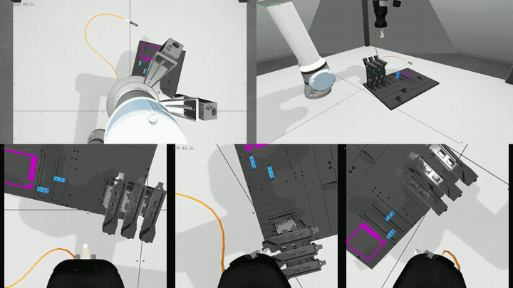

# Final cable-insertion demonstrations

Selected successful local replay of the published qualification **`eval_config.yaml`**, repeat 10: **276.3383/300**. These are the project's completion recordings.

| Trial | Scene | Score /100 | Original 20-fps video | Motion-trimmed GIF |
| --- | --- | ---: | --- | --- |
| 1 | SFP → NIC, 1 card | 95.27 | [MP4](sfp_one_card.mp4) | [GIF](sfp_one_card.gif) |
| 2 | SFP → NIC, 2 cards | 95.15 | [MP4](sfp_two_cards.mp4) | [GIF](sfp_two_cards.gif) |
| 3 | SC → SC, 3 cards | 85.92 | [MP4](sc_three_cards.mp4) | [GIF](sc_three_cards.gif) |

Each MP4 preserves the original full trial and five synchronized views (overhead, side, center, left, right), H.264/yuv420p, 1920×1080, 20 fps. The overview cameras are diagnostic recording views; the controller uses the three wrist cameras.

GIFs omit initialization using the first sustained **measured** TCP movement, with 0.2 s of preroll. They retain the remaining movement through the recorded terminal event, play at **2× speed**, and loop at 8 fps. Trim starts within the original clips are 6.648 s, 7.600 s and 7.650 s. GIFs simplify color and resolution for GitHub; use MP4s to inspect fine motion.

The controller is rule transport → requested-port RGB perception and guarded handoff → explicit insertion, with local contact recovery. No learned BC/RL actor or true simulator target pose steers these demonstrations. The published configuration was used for diagnosis: this is a selected successful recording, not an unseen-test result. The fixed repeat batch achieved **15/19 full passes and 53/57 individual insertion awards**. The simpler `sample_config.yaml` videos are separate.

[manifest.json](manifest.json) stores hashes, original archive paths, scores and trim provenance. Reproduce the exports with `scripts/export_final_project_media.py`; see [workflow](../../LOCAL_WORKFLOW.md). The three MP4s and three GIFs total about 24 MB and are intentionally versioned; bulk bags, datasets and model checkpoints remain outside Git.

[Project summary](../../robotic_cable_insertion_project.md) · [Experiments and limits](../../EXPERIMENTS.md)
