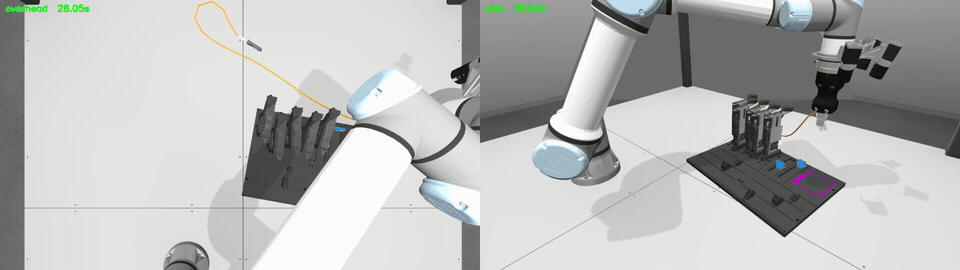
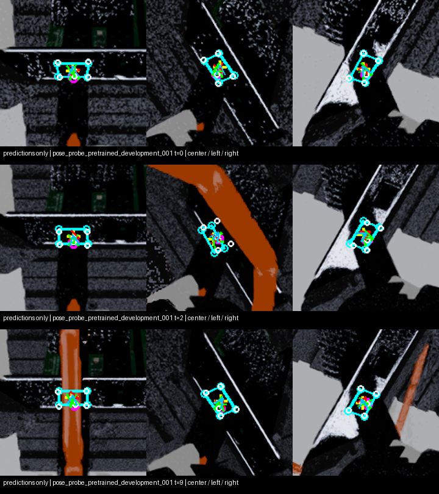
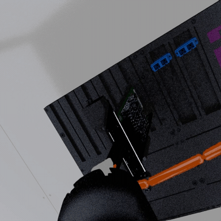
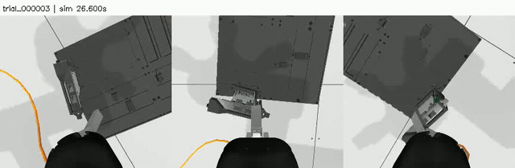
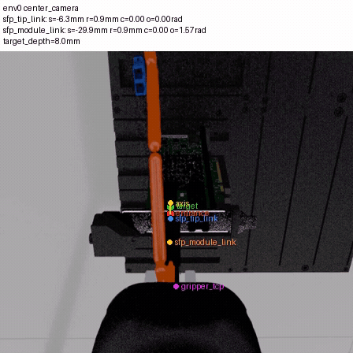

# Robotic cable insertion: planning, perception, and contact recovery

Written by Yoon Jung (yoonjung0705@gmail.com)

> **October 19 update:** Rule transport, requested-port image refinement, and an explicit image-based insertion controller scored **290.19/300 with 3/3 strict insertions on one selected public sample**. The separate released three-round diagnostic scored **98.75/300 with 1/3 strict insertions**; its two failures timed out during visual acquisition. Short contact-triggered backoff and sideways retry now run in transport as well as insertion. One five-card SC development transport recovered and reached handoff, but the released three-round run had no transport recovery trigger. These are different evaluation scopes; neither result establishes broad reliability. See [current status](STATUS.md) and the [transport recovery record](experiments/2026-10-19-transport-local-recovery.md).

This project tackles simulated insertion of a flexible cable connector into a small port while the robot works around nearby circuit cards. It combines high-level visual planning, collision-checked motion, camera-based pose estimation, imitation learning, and vision and contact-aware reinforcement learning. The experiments below use two different evaluation scopes: **full insertion from a transport start in Gazebo** and **local insertion from near the port in Isaac Lab** (Isaac for RL training near port).

## 1. Generate demonstrations around obstacles

I first used teleoperation, but started thinking if there's a systematic way to get expert trajectories. I used a vision-language model to choose an approach strategy (gpt-5-mini), MoveIt 2 for arm motion, trajectory smoothing for replay, and a privileged geometric controller for precise final alignment. Gazebo replay exposed a limitation of rigid-arm planning: the trailing flexible cable can interact with cards even when the arm has a valid path. I then hard-coded a low lateral bypass that descends behind the card row, travels beside it, tilts the plug in a clear area, and returns aligned to the selected port, producing **104 full insertions in 200 varied scenes (52%)**, spanning one to five intervening cards and two destination ports. Note this is a **privileged teacher** result (used information of ground truth target pose, obstacle positions, etc). Prior to insertion, the wrist was tilted according to the target pose, while ensuring the arm would not collide with the nearby cards.

*Successful privileged teacher route. [Older-route port blockage](images/cable_insertion/older_route_port_blockage.gif) provides a visual comparison*

## 2. Predict the plug and port from wrist cameras

A three-camera model predicts the plug point and four port-opening corners, then triangulates a relative 3D pose and correction direction. Training uses simulator geometry as labels; the review image below draws **predictions only**. Cyan marks the opening polygon, magenta the plug, yellow the opening center, and green the correction arrow. On 173 near-port decisions from six held-out episodes, lateral pose error was **0.278 mm median / 0.670 mm p95**, with **94.1%** correction-direction accuracy. The remaining tail motivated later work for fusing different channels.

## 3. Compare visual policies, then predict connector trajectories

I first trained ACT and a Dreamer v4-style policy on Gazebo demonstrations. ACT learned arm commands from camera images, robot state, and the task description. It did not use the plug-to-port pose estimate or learn to predict that pose. The Dreamer-style model learned to predict future visual and robot-state features as an auxiliary training task, then learned commands from demonstrations. It did not explicitly predict the plug-to-port pose, and its deployed policy did not use imagined rollouts. These were full-start Gazebo experiments, separate from the near-port Isaac Lab experiment below.

For the near-port task, I used the camera-based pose estimator from section 2 as a **frozen input** to a PoseInsert-inspired policy, alongside camera images, force, and robot state. Both the diffusion model and a simpler direct-prediction model learned the connector's desired **position and orientation** after each of the next four 50 ms movements, relative to the port. A fixed measurement of how the robot grips the connector lets the controller turn those predictions into gripper movements.

The direct-prediction pipeline seated **6/6** connectors on six development starts. Each rollout first used a simulator-based correction to restore the plug tip near its requested start pose; this temporarily overrode policy commands. After that startup step, the frozen BC policy controlled the connector without the force-triggered backtracking controller from section 4. These are **8 mm local seating** results from near-port starts, not policy-only results from the first frame.

*The left wrist-camera GIF shows one successful local seat. Its visible early backoff occurs during a rollout with the startup tip-restoration override enabled; the recorded policy takes over after the override releases. This is not the collision-recovery backtracking experiment in section 4.*

The world-model branch supplied a useful diagnostic: its supervised visual policy achieved **one full insertion in four development scenes** and reached a 25 mm opening envelope in **17/20** frozen scenes, versus **12/20** for ACT. Neither model fully inserted in the frozen 20-scene test. The preview is a **10× time-lapse of a one-frame-per-second recording** from the successful world model development scene, not a high-rate control video.

## 4. Detect blockage and retry with measured motion

I also tested a way to recover when the robot pushes but the connector stops moving. The controller compares commanded motion with **measured** robot motion and wrist force. If it detects a forceful stall, it backs along positions the robot actually reached, then lets the policy try again while limiting motion toward the blocked direction. Recovery commands are labeled separately in the replay data, so the learned policy is not trained to copy the retreat.

For this experiment, I started a probabilistic four-waypoint policy from the supervised controller and trained it with SAC-style reinforcement learning. The final RL policy matched, but did not improve on, its starting policy in a metrics-only eight-start test (**3/8** local seats each). In a separate recording-enabled run on eight near-port starts, the same RL policy seated **3/8 with recovery enabled** versus **1/8 without it**.

*The cable movement in the scene is due to scene startup*

## Historical development notes (through October 17)

> **October 17 current pipeline:** rule-based SC/SFP transport → requested-port coarse/native-image refinement and visual acquisition → explicit visual/proprioceptive approach to about **25 mm** → shared full-connector-pose BC insertion actor. Frozen sample-derived transport/handoff: **119/124** (SC22/24, SFP97/100); separate exposed released scenes **2/6**. Four-rollout insertion diagnostic: **SFP1/2, SC0/2**; subsequent complete sample **165.42/300 points but0/3strict insertions**. No recovery or newRL in either test. The actor no longer owns the entire150mm approach in this diagnostic. See [milestones and remaining gaps](STATUS.md#major-milestones--transport-handoff-and-insertion-october-17). Earlier dated running/queued statements are historical; step5 remains open.

<!-- current-continuation:start -->
## Current approved continuation — October 16

Rule transport brings either SC or SFP to a visual acquisition hold about 150 mm before the opening. A fresh requested-port pose and RGB-derived plug offset then initialize **one shared learned actor for the entire 150 mm approach and insertion**. Large hierarchical retreats return along measured poses to that acquisition hold and require fresh perception. The old 30 mm controller is historical.

**Training is running:** matched ImageNet versus visual-only transport initialization, same 13.725M full-target transformer, 30,000-update budget per arm. The fresh arm is active; the warm arm follows automatically. Actor data contain **67,039 examples from 500 usable source episodes / 377 physical reset configurations**: SC 102/30 train/validation episodes, SFP 319/49. All wider-source admission and estimated-frame audits passed. Predictions are complete recorded command targets in the visually estimated port frame, with causal robot/pose history and no privileged geometry input. Training error is not autonomous insertion success.

**Mandatory refiner retraining is complete**, including SC and SFP: 72,857 native RGB triplets from 497 original source episodes, followed by a targeted 20-episode SFP acquisition extension. Both base and repair reached validation plateaus. The strict repaired SFP offline component gate passes with the 0.95 projection threshold; this projection flag is not calibrated confidence or certified physical visibility.

**Launcher audit correction:** several newer host environment settings were not forwarded into Docker. The recent SFP live10 result remains 10/10 correct acquisitions, but actually used projection threshold **0.90**, not the intended 0.95. The active SC broad60 uses the **new repaired native refiner**, not the separately specified older SC checkpoint. Preserve these results under their actual configuration; they do not certify the intended family bundle. Let the frozen SC job finish. A separate corrected launcher records the effective container environment and forwards these settings for subsequent matched tests. The original launcher/source hashes remain intact during active evaluation.

The hierarchical runtime is implemented, including retained pre-return RGB/state, coherent lateral supervisor retries, measured route retreat and reacquisition. **28 focused contract/recovery checks pass; live actor/recovery validation is still pending.** Supervisor exploration is not RL. No new SAC/SERL, reward model, imagination or reserved-final evaluation has run. Keep final scenes sealed and at most four project GPUs including untouched legacy GPU0.

Next: finish matched BC fits and current frozen SC acquisition evaluation; verify corrected runtime settings; run fresh autonomous full-depth development rollouts, diagnose failures, then compare no/local/hierarchical recovery with identical actors and scenes. Advance to RL only after the supervised insertion gate.

See [execution record](experiments/2026-10-15-rule-perception-hierarchical-execution.md) and artifact `state.json` for exact commands, failures, comparisons and paths.

**Additional SC coverage repair:** the29 existing rail-expansion episodes added4,526 RGB-proposed native crops (22/7 complete train/validation episodes) after label/split/visual QA. The joint SC+SFP repair reached a validation plateau at4,000updates. It passes9/9 previously rejected SC probes versus0/9 for both baselines, and improves new-rail accepted components166→211. Overall accepted components3722→3711 is a small regression; zero wrong/absent accepts remain. The original strict gate failure is preserved. A separately documented20-scene live diagnostic is running; the new checkpoint is **not promoted**. Black-gripper-only crops explain some large pixel-error tails and are not evidence of visible targets. Active frozen models/scenes remain unchanged.

<!-- current-continuation:end -->

## October 15 autonomous continuation: current evidence

### October 16: acquisition repair and actor-data readiness

**No new insertion BC or RL checkpoint has been trained yet.** Mandatory SC/SFP native port refiner retraining is complete to plateau. The approved learned actor still owns the entire 150 mm approach, with starts buffered to 180 mm. Large retreats must return to a measured acquisition checkpoint and obtain fresh port/grasp locks.

- **SC:** the old checker run stopped under its failure rule at 36 qualified / 41 completed of 60 planned, zero wrong ports/harm. Its code is archived with all eight frozen source hashes verified. The new single-request native-five pipeline, bounded 140 mm visual correction and measured hold gate achieved **7/7 correct acquisitions**, opening errors 0.077–0.363 mm and zero wrong/harm. All global inference p95 values are below 128 ms; one perception-active subset is 306.8 ms. Thus its stricter latency gate is **6/7, still open**. A same-scene diagnostic separates Gazebo rendering from policy inference while respecting four project GPUs. Models/scenes are unchanged. A single-point 64 px relaxation remains rejected because it accepted an absent target; the replacement five-landmark geometry rejects that case.
- **SFP coarse:** full-data recorded-image performance improved substantially, but the unchanged live six-case gate remains 3/6. Existing image history did not repair the three failed traces. A bounded twenty-reset acquisition-state repair is collecting ten training / ten validation configurations across 1–5 cards, both ports and all requested card codes, then fitting source-balanced current/history heads while retaining the full old corpus. The first two all-camera label overlays were inspected. It predicts projected-in-frame status, not certified physical visibility or learned confidence. Require at least 9/10 fresh correct acquisitions and zero wrong/harm before promotion; otherwise change the representation instead of routine recollection.
- **Grasp estimate:** a separate native SFP plug-offset model plateaued after 15,000 updates on 6,115 triplets from 307/47 train/validation sources. Across all phases its position p95 is 0.505 mm, failing the 0.4 mm gate; worst images hide the plug inside the port. In the actual runtime acquisition scope—after a causal visual port lock, with public measured TCP at least 120 mm before the opening—position p95 is **0.150 mm on 272 observations / 39 held-out episodes / 31 resets**. Translation is approved only for that scope and is locked before insertion. Orientation remains diagnostic and is not an actor input. Do not update this estimate from an inserted, hidden plug.
- **BC data:** 454 qualified original expert sources now have causal RGB port locks. Requiring a legal three-observation grasp lock leaves **432 sources / 51,667 rows**: SC 80/20 train/validation episodes and SFP 293/39. The other 22 successful SFP recordings are preserved, not called bad experts; they lack an approved early free-grasp lock. Earlier rows are never backfilled. Original data remain untouched, with a separate exact actor-pixel cache on NAS.
- **Wider demonstrations:** SC first-thirty admission passed: 22/30 physically qualified episodes, from ten original training reset configurations. All three SFP pilots at 90/150/180 mm, including lateral/8-degree offsets, fully inserted at 46.776 mm depth and 0.247–0.382 mm lateral error without scored harm. These are privileged teachers, not learned-policy successes. SFP first-thirty collection reuses those three pilots. Ten held-out wider starts per family are queued before the matched BC comparison.

Preflight fixes for the upcoming actor: complete port-frame targets for both families, exact recorded force/trajectory profile, plug-based near-port phase weighting, command-feedback masking in BOTH current and historical state, and identical native-JPEG preprocessing during training and deployment. The old 15 mm command cap would clip about 11% of SC and 27% of SFP expert chunks; the new controlled runtime must use the audited 60 mm component cap. Visual warm starts now reject silently empty/incompatible transfers; the comparison retains fresh current-data state normalization. Four real history offsets are planned, with the history-masking ablation OFF.

Rootless runs use private bridge networks and unique Gazebo partitions. Cooperative per-GPU locks serialize future rollout/training workers without interrupting active jobs. Legacy GPU0 is untouched. Current work uses GPUs3/4/5 plus that legacy allocation. Final scenes remain sealed; reward/imagination and new actor-Q training remain gated. See the [execution record](experiments/2026-10-15-rule-perception-hierarchical-execution.md) for commands, failed comparisons and artifact paths.

### Latest: rail coverage, clean simulation isolation and rule pilots

**Current gates remain open.** Mandatory native refiner retraining is complete to plateau on both families, but live acquisition still needs repair before the new 150 mm insertion actor can be trained and promoted. No new insertion BC or RL actor has been trained in this continuation.

The SC coarse failure has a concrete data gap: old SC0 rail translations cover roughly −2 to +18 mm and SC1 −60 to −43 mm, whereas the released range spans −60 to +55 mm. Even the 95 failed original collections do not fill that gap. An old-layout current/history locator fit cannot establish generalization to these missing port arrangements. The bounded repair collects 29 new physical reset configurations across the rail range, both requests, 1–5 cards and absent-other-port negatives. These are perception-only recordings, not successful insertion experts. Native overlays from the first two runs were inspected and passed causal-label QA. Current/history fits use grouped splits and balance original versus expanded-layout sources; live correct-port acquisition remains the promotion gate.

The first six SFP rule-transport cases yielded **1/6 fully qualified acquisitions, zero wrong-port handoffs**. The one pass stopped about 148 mm before the port, 5.7 mm laterally off-axis, with 0.324 mm visual opening error. Several failures waited at the elevated acquisition plane without a usable visual lock; another reached the region but could not sustain the stability gate. A bounded matched pilot tests acquisition at the nominal 150 mm plane. It does not relax the visual handoff gate. This is rule transport only; no insertion actor ran.

Three repaired SC teacher starts now pass independent raw-bag terminal checks, including 150/180 mm lateral/orientation offsets. Depth is 15.57–15.59 mm, lateral error 0.15–0.46 mm, with no scored harm. A smaller reset integral gain fixes measured oscillation, and 6 mm/s axial insertion reaches full depth before the simulator completion event freezes motion. These are privileged teacher demonstrations. Restart only the bounded 30-attempt teacher gate with this controller; require at least ten independently qualified successes before expansion.

BC preparation now has **53,921 command rows from 454 qualified source episodes**, including SC and SFP. All sources have matching completion events; 4,822 later commands are excluded. Episode IDs include source-path hashes to avoid basename collisions. Four labels are actual active complete TCP targets at +50/+100/+150/+200 ms. Original data are preserved. Body-command conversion uses preceding header-time TCP and is explicitly an approximation to RT-consumption state; a four-episode audit measures p95 discrepancy of 0.07–0.12 mm. Causal RGB-derived port locks are still needed before this becomes an actor-ready dataset.

A confirmed infrastructure bug affected two later runs: concurrent host-network containers shared Zenoh port 7447 and Gazebo discovery despite separate ROS domains. Both launchers now use private bridge networks and unique Gazebo partitions. Audits found no conflict warnings in the 454 admitted original sources or the frozen 12-run SC comparison. Failed infrastructure runs remain preserved and excluded from policy evidence.

See the [execution record](experiments/2026-10-15-rule-perception-hierarchical-execution.md) and artifact-root `state.json` for commands, exact counts, failures and subsequent updates. Earlier October 15 paragraphs below are intermediate history where they describe running jobs or older derivatives.

### Latest acquisition gate and BC-data preparation

The completed frozen SC comparison failed promotion: old stack **3/6** correct acquisitions, new point refiner plus association **1/6**, zero wrong accepts in either arm. No insertion actor ran. The bounded replacement of the legacy presence veto then accepted the neighboring port in **1/1** diagnosis (56.21 mm opening error): **rejected**, not a safe fix. Exact-frame replay reproduces the association scores to within 0.000041 and finds contradictory identity evidence in one camera; there is no established simple state-range or frame-conversion explanation.

A distinct crop-proposal repair is being tested: a public-request-conditioned locator chooses one SC region per camera from all three current RGB feature maps and optional 40 mm / 10 degree motion-spaced context. It omits absolute TCP coordinates and retains relative motion for history. On 83 training / 21 validation episodes, current-only and history heads both reach about 10.9 px coarse p95 with zero nearest-wrong-port views among 14,235 labeled in-frame views. Both initial fits hit an update cap; separate weight continuations seek a plateau. Fresh live diagnosis remains necessary. This predicts projected-in-frame status, not certified physical visibility.

The first BC command derivative contains 46,910 rows from qualified original sources, but 78 sources had stale archived image paths. A corrected derivative is rebuilding from the audited native-image provenance fallback. Original datasets and failed derivatives remain intact. Robot state is reconstructed as 32 dimensions from preceding controller/joint/wrench observations; actual public task codes have 10 dimensions. Four labels are the recorded active TCP targets at +50/+100/+150/+200 ms. Targets held between message publications remain genuine command supervision. Static pauses are thinned in the copy without joining actions across removed time. No future measured pose supplies an action label. Six QA panels were saved and SC/SFP examples visually inspected. Estimated port locks must still be produced before actor training.

All three initial wider SC teacher successes passed a separate raw-MCAP, pre-return audit: depth about 15.568 mm, lateral 0.082–0.117 mm, orientation about 0.012–0.013 degrees, no scored harm. A bounded 30-attempt batch covers both ports and 1–5 cards with 90/150/180 mm starts and offset perturbations. Some supervisor resets fail; these are not BC experts. Diagnose the completed batch before expansion; at least ten independently qualified successes are required. A successful teacher video is `wide_approach_pilots/wide_sc_pilot_02_event_v5/five_cameras_20fps_grid_active.mp4` under the artifact root.

The approved pipeline is rule transport → requested-port acquisition/refinement → one shared learned insertion actor owning the full 150 mm approach. Training should buffer starts to 180 mm. Large hierarchical retreats return to rule transport and require a fresh visual lock. The old 30 mm controller is a historical control, not part of this pipeline. BC and recovery comparisons remain open; no new RL has been trained in this continuation.

**Refiner retraining is now complete to a validation plateau.** The corpus contains 72,857 original RGB triplets from **497 source episodes / 633 named image streams / 422 physical resets**. These are different counts; image-stream IDs must not be counted as independent episodes. Source episodes: SC 83 train / 21 validation, SFP 340 train / 53 validation. Physical reset groups are disjoint across splits.

A matched SFP component test combines the stronger requested-port coarse locator with the new native refiner. The five-landmark pose variant accepts 356/1,120 sampled triplets with zero wrong-port accepts, versus 324 accepted by the old component. Conditional position/lateral/orientation p95 is 0.447 mm / 0.189 mm / 0.708 degrees. It fits translation and yaw using a training-only fixture normal prior; arbitrary tilted fixtures are not established. The set has 70 image-stream IDs but only 53 source episodes / 45 physical resets. These are component results, not autonomous insertion success. Preloaded-image perception p95 is 20.46 ms; complete live latency remains unverified.

A diagnostic global orientation head previously used simulator card count, which is absent from the public task. Those old results are quarantined and must not support deployment claims. Its corrected public-input control has now plateaued: SC/SFP angular p95 2.33/3.27 degrees, versus state-only 4.80/4.08 degrees. The native landmark fit above remains the more precise component candidate.

Independent geometry, official insertion score and contact/force records admit **454 source episodes** for subsequent BC preparation: SC 80 train / 20 validation, SFP 307 train / 47 validation. This is an admission index, not yet a materialized action-chunk dataset. Ownership, image-time state joins, stall cleaning and predicted-frame targets remain mandatory. Original data are untouched. Failed or shallow recordings can remain useful for perception without becoming successful BC experts.

The wider SC teacher now demonstrates full insertion from all three diagnostic starts, including a 180 mm approach and lateral/orientation offsets. The third case originally returned before the simulator contact timer completed; waiting for the teacher-only completion event fixes its official score to 75. These are privileged teacher demonstrations, not actor successes, and require independent raw-bag geometry/force checks before expansion. The first 30 wider attempts must contain at least 10 qualified full insertions before collection scales.

The frozen six-configuration/two-arm SC acquisition comparison has completed and failed its gate. The legacy-veto replacement also failed a wrong-port test; see the latest update below. No final scenes have been opened.

Artifacts and exact commands: `/home/nas/chmin/aic_archives/2026-10-15_rule_perception_hierarchical_v1/`. Detailed chronology: [execution record](experiments/2026-10-15-rule-perception-hierarchical-execution.md).

**October 15 execution update:** Broad SC/SFP native refinement now improves opening-position accuracy: conditional SC lateral p95 is 0.20 mm; the stronger SFP coarse pipeline plus the new refiner improves lateral p95 from 0.82 to 0.29 mm on 70 validation recordings, with zero observed wrong-port accepts in that comparison. Training continues because the first 12,000-update fit was still improving. Coarse identity repair remains experimental: rejecting known wrong handoffs also rejects some correct ones. Wider 150/180 mm SC teacher pilots now reach full seating after measured alignment and a corrected completion condition; broader data admission is still gated. New insertion BC, deployed hierarchy and RL have not passed their gates. [Evidence and active execution](experiments/2026-10-15-rule-perception-hierarchical-execution.md).

**October 14 current execution:** Supported normal-board SC rule transport and RGB handoff passed small screens. Matched corrective-data, decoder and 6-second robot-history repairs did not pass autonomous full insertion. A separately frozen observation-only approach reached **29.12 mm before the opening / 0.148 mm lateral**, then the unchanged trained actor achieved **11.07 mm insertion depth / 0.413 mm lateral / 0.94° orientation error** on one reused start. Official score 75, but the unchanged ≥14 mm physical gate failed. Logs confirm contact-triggered completion and end-effector locking; no cable snag explains this run. This is meaningful approach progress, not a promoted insertion policy. All new jobs finished; no routine collection, RL, world-model work or final-scene access. SFP local insertion, rotated SC and port-0 rail minimum remain unapproved. [Execution record](experiments/2026-10-14-transport-handoff-execution.md) · [Easy explanation](answers/2026-10-14-autonomous-execution-outcome.md).

**October 7 latest transport finding:** Observation-only selected-port
perception is accurate enough to provide an early SFP transport cue on the
three saved failed-actor routes, but two matched full-action actor fits
largely ignored that cue and failed their offline gates. The last independent
autonomous transport result remains 0/3 safe arrivals for both actors.
Simple feature concatenation and more of the same late corrective BC are
stopped. The next distinct idea needs an explicit route-error/progress
control objective and useful actor-visited recovery targets, while keeping
true port geometry out of the deployed actor. [Evidence, overlay and
artifacts](experiments/2026-10-07-sfp-early-branch-support.md#route-feedback-ablation-result-the-pose-is-visible-but-this-actor-ignores-it).

**October 7 earlier transport gate:** The newest truly unseen 2/3/5-card
SFP matched actors both missed all three safe buffered arrivals. Recoverable
late actor states yielded six safe train-only teacher continuations, but a
final matched late-correction fit improved held-out action p95 only 3.5%
against a fixed 10% gate. The actor is not promoted. The next bounded test
shadows the frozen requested-port perception model on saved off-route actor
views before any explicit route-feedback actor fit. Automatic handoff,
insertion and RL remain disabled; reserved final scenes stay sealed.
[Evidence and exact artifacts](experiments/2026-10-07-sfp-early-branch-support.md).

**October 6 paired-port and coordinate-prior follow-up:** Explicit local rail/port-pair supervision did not yield usable guarded coverage (2/10 early development groups), and a state/RGB-rail coordinate prior was too imprecise (111 px held-out p95) to rule out neighboring cards. The previously trained single-point native crop model remains an offline reference, not an automatic handoff. Next establish whether existing full-row RGB views actually identify the requested numbered card; if not, plan a safe observation view or route change. Transport remains a separate 0/3 safe-arrival failure. [Experiment](experiments/2026-10-06-sfp-local-card-pair-repair.md).

**October 6 joint perception decision:** The three-camera candidate matcher reached 10/10 early groups on ten newly captured nonfinal SFP scenes but accepted eight points on a neighboring card after two-frame confirmation. A frozen single-point crop model was safer on those same images, but had incomplete early coverage on the prior ten-scene check. This identifies requested-card identity, rather than simply geometric consistency, as the next perception repair. No automatic handoff, insertion-policy rollout or RL was enabled; autonomous transport still missed safe buffered arrival in 0/3 latest tests. [Experiment](experiments/2026-10-06-sfp-joint-camera-candidates.md).

**October 6 decision:** A slot-local board head provides observation-only requested-card crop centers. The 480 px crop covered the selected opening early in 10/10 development and 10/10 additional nonfinal scenes, but a trained request-conditioned crop refiner delivered an early three-view-consistent pose in only 6/10 extra groups. It made zero accepted wrong-port calls and 1.80 mm accepted 3D p95 where it accepted. Original-image overlays show confident per-view choices on neighboring ports; the next perception test must match several candidate openings across cameras jointly. Transport has not yet reached safe buffered arrivals on 0/3 saved autonomous starts. Keep the handoff, insertion actor and RL off. [Current status](STATUS.md) · [detailed experiment](experiments/2026-10-06-sfp-slot-conditioned-crop-feasibility.md).

**Current SFP perception boundary, October 5:** Transport still has to reach a safe waiting region, and the selected port must be verified before switching to insertion. A new RGB-predicted **five-rail, slot-local occupied/empty head** solved its bounded slot-map tests (10/10 grouped development, 10/10 extra disjoint nonfinal teacher scenes, 3/3 sparse saved actor routes), improving on a pooled head's 5/10 and 5/10. It does not certify the requested port. The first causal 3D rail-to-port check rejected wrong detector proposals but found a stable two-endpoint board reference in only 2/10 scenes, largely because predicted endpoints did not reproject consistently between cameras. Next test an observation-only robust two-view board fit, then address selected port correspondence and safe stopping on new autonomous development starts. No automatic handoff, insertion continuation or RL is enabled. [Current evidence](experiments/2026-10-05-sfp-slot-local-occupancy-ablation.md) · [full status](STATUS.md).

**October 5 follow-up:** Two frozen RGB port locators identified the requested port early on all three saved one/two-card autonomous routes, with zero accepted swaps; the transport actor still reached no safe buffered arrival. This shows coarse target visibility can exist without the action policy using it effectively. The harder ten-request/five-card early-identity gate remains failed, so the proposed spatial actor was not trained. The next bounded work is to distinguish wrong slot selection from absent or occluded targets on original images, then retest a slot-aware visual representation before connecting it to transport. [Prerequisite audit](experiments/2026-10-05-spatial-transport-prerequisite.md).

**Current direction, October 5:** A targeted expansion added 29 fully inserting SFP alternate-request teacher routes and 7,584 action chunks across one to five cards. The corrected transport actor reduced held-out first-action error but still missed the requested buffered approach on all three new autonomous development starts. The frozen learned stop head remained at 2/10 timely teacher events after more data; the task-selected final-action and early-branch sampling diagnostics also failed their gates. The base-frame potential region is a mandatory *veto* for any future learned stop, not evidence that the requested port is identified. Next test a spatial, request-conditioned visual representation for the route decision, then separately validate target identity and safe handoff before insertion or RL. See [current status](STATUS.md) and the [full record](experiments/2026-10-05-transport-route-handoff-continuation.md); older sections retain provenance.

**Current direction, October 4:** The earlier optimistic SFP crop result below was overturned by fresh ten-scene testing: neighboring-port accepts remained, and autonomous SFP transport did not reach a safe requested-port buffer on its matched three-scene gate. The updated pipeline uses one shared coarse three-camera history model to propose a **current-image requested-port crop** and decide whether to pause for precise inspection. The old late camera-check responsibility belongs to its proposal-conditioned accept head. A separate refiner and port-relative insertion actor follow only after safe identity/pose checks; RL remains gated. Measured-travel history is provisionally 30 mm/up to twelve triplets, awaiting autonomous replay and latency checks. The kernel key quota was raised to 1024, and the ten fresh nonfinal scenes were completed. See [status](STATUS.md) and the [active execution plan](experiments/2026-10-04-coarse-shared-history-execution.md); older sections here retain experiment provenance.

# Current SFP coarse visual anchor, October 4

An original-image crop centered from observed port pairs and known rail spacing improved the offline availability of the requested SFP port anchor. A frozen combination of four locators acquired 9/10 requested ports within three seconds on reused development traces and all ten eventually. These are **coarse perception results**, not autonomous transport or insertion. Checkpoint selection reused those traces, and rootless Docker can now start one minimal container at 199/200 keys, though the key quota remains fragile and fresh Gazebo tests have not yet run. The next gate is ten new non-final reset groups with models frozen, including wrong-port safety and complete <300 ms inference, before connecting this anchor to transport. [Detailed evidence](experiments/2026-10-04-sfp-observed-rail-crop.md).

**October 4 SFP coarse-perception finding:** The requested opening is apparently exposed in most marked middle-card camera crops, yet a selected-only locator and one structured all-slot repair still confuse neighboring card identities. The structured model acquired an early coarse anchor in 7/10 complete development episodes, below the 9/10 gate, despite 2.14 mm p95 on accepted estimates and zero accepted wrong ports at its selected checkpoint. The camera-consistency rule rejects the swaps rather than passing a wrong target to transport. The next key problem is observation-only rail-slot association or safe active viewing when the target is ambiguous; precise near-port PoseInsert remains separate. No transport, insertion or RL promotion follows. [Experiment](experiments/2026-10-04-sfp-middle-card-identity-repair.md).

**October 3 coarse-route finding:** The model can tell whether a stock SFP CheatCode route is approaching or descending (98.7% on grouped development episodes), yet predicts the early next waypoint with 67.6 mm p95 error. The explicit route-stage idea therefore does not repair the failed transport actor on its own. A selected-target spatial anchor from wide original-resolution views is the next bounded hypothesis for transport; it is distinct from the precise near-port pose needed for PoseInsert. No new actor, RL policy, automatic handoff or final-scene result follows from this probe. [Evidence](experiments/2026-10-03-sfp-route-stage-waypoint-probe.md).

**October 3 SFP transport decision:** A privileged teacher can recover from the actor's early wrong route on three development starts, but a ten-episode full-action corrective BC continuation still reached **0/3** autonomous selected-port buffered arrivals. Offline action error improved while the closed-loop route failed. This strengthens the case for an explicit, observation-predicted route stage or next subgoal before the later one-requested-port visual check and PoseInsert handoff. The corrective actor, automatic switch, insertion and RL remain unpromoted; no final scenes were used. [Evidence](experiments/2026-10-03-sfp-balanced-arrival-onpolicy-check.md#october-3-bounded-corrective-full-action-continuation-failed-live-gate).

**October 3 SC handoff finding:** A guarded visual rotation corrected a real port-0 transport posture from 6.73° to below 0.14°, but the original selected-port head lost confidence after rotation. An exact same-image test isolates its dependence on measured TCP quaternion. A quaternion-masked refit recovered real-port recognition but accepted 11/100 absent-port triplets on a new reset. Automatic handoff, insertion and RL remain closed; next require orientation-invariant identity **and** reliable absent-port rejection before attaching an actor. [Experiment record](experiments/2026-10-03-sc-orientation-identity-repair.md).

**October 3 selected-port handoff status:** A new request-conditioned original-RGB crop identity classifier failed on four independently frozen SC one-port resets: 102/135 projected selected-port triplets recalled and 25/144 absent-port identity accepts, versus 134/135 and 0/144 for the frozen spatial identity head. The known port-0 missed identity became a 6.71° TCP posture rejection when using the crop. Keep the spatial selected-port check; the automatic transport-to-insertion switch, insertion continuation and RL remain gated. Next trace and correct the port-0 transport posture under a bounded matched test. [Detailed result](experiments/2026-10-03-sc-original-rgb-crop-identity.md).

**October 3 supervised handoff result:** In a frozen review, the requested-port identity model accepted a saved SC stop whose tool orientation was wrong by 6.7°. Training the existing RGB orientation head with one-port examples reduced new-reset near-port error from 7.80° to 4.65° p95, while a safe switch needs the 3° gate. SFP candidate matching improved different-card confusion but still has adjacent-port mistakes. The project keeps transport, selected-port verification, and insertion as separate stages, with the automatic transition and RL disabled pending a stronger original-resolution orientation/identity test. [Experiment and next bounded repair](experiments/2026-10-03-frozen-handoff-gate-and-orientation-repair.md).

**October 3 selected-port update:** The SC identity head still accepts a known wrong-posture transport stop. An SFP candidate matcher trained with both visible-target and offscreen-distractor examples from the same reset groups rejects 4/4 saved wrong-port proposals while retaining 69/69 correct ones, but grouped false accepts, orientation, occlusion, and full live latency remain unresolved. The design remains transport → verify the requested nearby port and safe posture → insertion; the automatic switch is disabled. [Evidence and next gate](experiments/2026-10-03-selected-port-correspondence-continuation.md).

**Current selected-port progress (October 3):** On four new one-port SC development layouts, a spatial model conditioned on the requested port code plus a strict three-camera rule rejected 109/109 requests for a physically absent port and retained 96/100 real openings projected into every view. The matched pooled-image head rejected far fewer wrong requests. This demonstrates a promising *SC identity* repair, not safe insertion: some single-camera predictions still confuse ports, projection does not certify visual clarity, and SFP wrong-port, hard occlusion, complete live latency and autonomous handoff remain open. We keep the switch to insertion disabled. [Exact comparison and artifacts](experiments/2026-10-02-sc-absent-port-identity.md#spatial-selected-port-continuation-on-new-reset-groups).

**Earlier perception safety failure:** The original camera-agreement check precisely localized a blue SC connector but assigned it the wrong requested identity. In a bounded request-swap test it accepted 16/16 requests for a nonexistent second port by returning the visible first port. The original SC training images all had both ports; small presence-only and pooled-image probes did not generalize to one-port layouts. The spatial continuation above repaired this failure in a narrow grouped SC test, but independently checked visibility remains open. This counterfactual stress test is not a measured production failure rate. [Detailed comparison](experiments/2026-10-02-sc-absent-port-identity.md).

**October 2 verification update:** The three-camera SC predictions agree geometrically in 49 reviewed clear approach frames across three new layouts. A provisional three-view rule rejected 20 hidden examples in an older small review, but it is not yet a safe handoff test: the difficult occlusions and wrong-port requests need independent grouped evaluation, and valid-arrival recall for the complete rule is unknown. The transport-to-insertion switch and full insertion remain unvalidated. [Diagnostic details](experiments/2026-10-02-selected-port-handoff-execution.md#bounded-three-camera-disagreement-diagnostic).

**October 2 SC local perception result:** The RGB coarse locator followed by
an original-resolution selected-port crop found either requested SC opening
on three new development layouts at **0.230/0.175/0.149 mm lateral p95** in
reviewed clear views. The crop uses the image prediction, not simulator port
geometry. True target visibility under occlusion, orientation on these scenes,
the two-stage switch, and autonomous insertion remain unproven.
[Evidence and overlays](experiments/2026-10-02-selected-port-handoff-execution.md#continuation-native-sc-crop-second-target-and-grouped-visibility-review).

**October 2 selected-port perception check:** A small frozen-backbone SC
locator repair removed large wrong-object detections on two new development
layouts, including five cards. Three-view port-frame lateral error fell from
16.64/29.74 mm p95 to 1.43/1.26 mm p95, still above the 0.5 mm insertion
corridor. A corrected original-RGB review found four high-score false-visible
SC cases in a provisional 20-negative sample; SFP visibility labels remain
unresolved. This is a diagnostic result, not an integrated handoff or insertion.
[Measurements and image overlay](experiments/2026-10-02-selected-port-handoff-execution.md#independent-five-card-replication-and-3d-consequence).

**Active October 2 direction:** Use a task-conditioned transport actor to
approach the requested destination, then treat its arrival signal as a
**request to pause**. A near-target perception model will identify **only the
requested opening**, returning its pose and per-camera identifiable visibility
or declining to estimate it. A verified safe waiting pose then hands control
to a separate port-relative insertion actor. A learned pose-confidence head
is deferred. This two-stage switch is a [planned experiment](SELECTED_PORT_HANDOFF_PLAN.md),
not an achieved full-start insertion result; current wrong-port and
wrong-route failures remain open.

**October 2 transport-to-insertion stop check:** On seven frozen SC
development trajectories, camera-assisted standoff stopping identified five
valid waiting poses versus two for a transport-only head, but it made one
false handoff on a wrong route (1.02 mm position, 6.71° orientation).
A matched live pair followed different routes, preventing a causal
performance claim. A separate SFP replay found wrong-port accepted poses
when card 0 was absent. Thus no general visual-stop or insertion-policy
promotion is justified. [Measured comparison and videos](experiments/2026-10-02-transport-stop-comparison.md).

**October 2 supervised recovery update:** A stage-preserving privileged
teacher fully inserted after 20 failed actor decisions in 10/12 five-card
SFP attempts across all ten selected card/port identities. These are
teacher-assisted recovery examples, not autonomous insertions. Their 1,392
admitted RGB-pose-labeled action rows produced only a small matched BC gain:
held-out near-port lateral target p95 1.82 to 1.72 mm, while both actors
retreated on all nine tightly aligned frozen live observations. The
predeclared action gate failed; RL and final scenes remain closed. The
recorded corrections mostly start after the initial handoff phase, which is
the next specific hypothesis to test before more collection.
[Evidence and artifacts](experiments/2026-10-02-two-family-perception-local-bc.md#bounded-on-policy-correction-comparison-declared-before-training).

**October 2 active limit:** On a tested five-card SFP reset, the RGB system
estimated the selected opening within about 0.11 mm lateral and 0.086°;
complete inference p95 was 235 ms. The scored plug tip began 35.9 mm before
the opening, but the trained local actor later missed by about 20 mm sideways.
Reexpressing 2,356 recorded native expert rows in the new RGB frame gave only
a small held-out BC gain and no live promotion. The next bounded test asks
whether the actor can avoid retreating from tightly aligned pre-opening
states. This does not establish full-start insertion, SC control, or actual
occlusion visibility. [Detailed experiment](experiments/2026-10-02-two-family-perception-local-bc.md#october-2-immediate-lock-failure-and-matched-actor-frame-repair).

**Latest local-insertion result (October 2):** A selected-port RGB cascade
uses the public card/port task code, original-resolution crops, and three
camera views. On accepted old development frames, lateral pose error is about
0.35 mm p95; true occlusion visibility and calibrated confidence are not yet
solved. Ten additional five-card SFP-to-NIC privileged expert runs all fully
inserted, but merely adding them did not make the full-image target selector
reliable on grouped held-out layouts. Their recorded TCP-frame delta commands
now convert causally into estimated-port-frame action labels. The new
39-scene insertion actor moved 37.4 mm forward from a matched near-port
handoff, versus 8.5 mm for the previous actor, but still scored 0 and stopped
roughly 16.5 mm short of the successful teacher's final TCP position.
Read-only Gazebo contacts identify a plug-tip/card block in the older run and
cable/card contact during approach. Privileged ±3 mm / 4° correction pilots
fully inserted and are being used only to create supervised recovery labels.
The [current evidence](experiments/2026-10-02-two-family-perception-local-bc.md#october-2-follow-up-new-sfp-starts-body-frame-targets-and-live-contacts)
keeps full autonomous insertion and RL as open gates.

**Current experimental limit (October 2):** The shared long-history transport actor plus an observation-only two-port locator and late visual servo reaches the measured SC pre-insertion pose on several development starts. An improved visual stop returns promptly, but early cable-safe route following remains inconsistent: one five-card run was about 94 mm from the teacher route at p95, and a smaller action cap improved one layout while worsening another. These transport-only trials do not establish autonomous full insertion or an RL result. A base-frame phase-waypoint probe missed its grouped held-out 20 mm gate and was not deployed. The next gated repair is a camera landmark/corridor observability test for the late route; [the experiment record](experiments/2026-10-01-transport-reliability-continuation.md) has exact commands, scores and failures. Reserved final scenes remain sealed.

### Historical October 16 continuation

Mandatory SC/SFP native refiner retraining is complete to plateau. The targeted SFP coarse repair also plateaued; on the same 1,120 held-out triplets it accepts 917 versus the old 913, with zero wrong ports. Native refinement rejects all 14 new coarse absent-target false positives. The ten-case live gate is still running; this small component change is **not** a live success claim. Its first failure reaches the correct image region but exceeds the native geometric residual gate. See the [execution record](experiments/2026-10-15-rule-perception-hierarchical-execution.md) for the inspected predicted/label overlays, full metrics and bounded diagnosis.

The new `RunRuleThenSharedRecovery` integration is implemented but unvalidated: SC/SFP rule transport -> fresh RGB port/grasp locks -> one shared actor owning the entire150mm approach -> measured-path local/hierarchical backtrack. Large retreats return to the measured acquisition checkpoint and require fresh perception. Pending chunks/history are cleared, contact never retares initial load, and supervisor commands are logged separately. **No new insertion BC or RL has been trained yet.** Wider training/held-out demonstrations and matched fresh versus visual-warm BC remain in progress. Final scenes remain sealed and the project limit is four GPUs including the untouched legacy allocation.

SC's targeted separate-GPU latency case passed (active p95 239ms, opening error0.414mm); the earlier seven-case single-GPU strict result remains6/7. Current status and exact artifacts are in [STATUS.md](STATUS.md) and the execution record.
