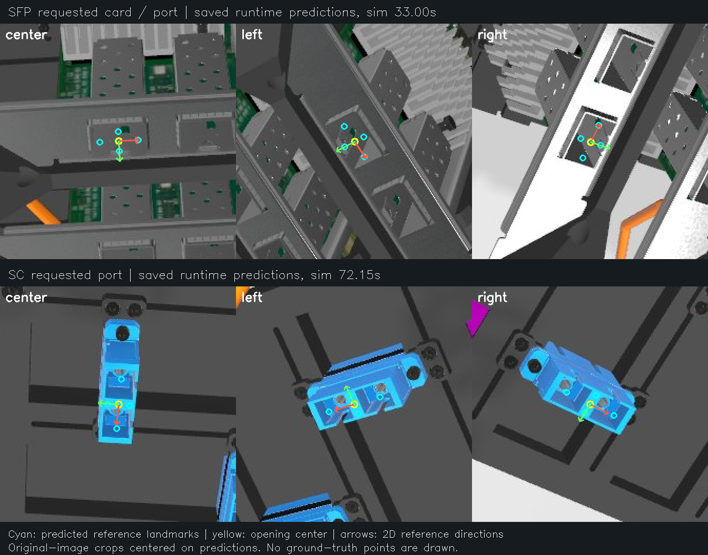
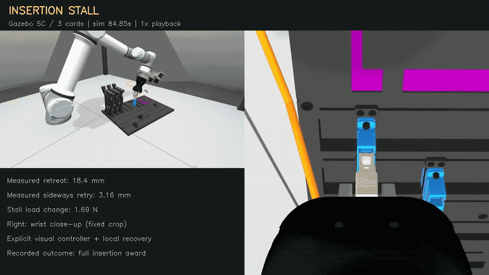

# Robotic cable insertion with geometric vision and contact-aware control

**Yoon Jung** · yoonjung0705@gmail.com

Built an autonomous simulated cable-insertion system for Intrinsic's AI for Industry Challenge, handling **SFP-to-NIC and SC-to-SC** tasks around circuit cards. Three wrist cameras, robot motion and wrist force drive a pipeline of **cable-aware transport → visual handoff → connector alignment and insertion → contact recovery**. The final demonstrations use learned perception and explicit control; a learned BC or RL actor does not supply their actions.

| SC-to-SC: bypass three cards, then insert | SFP-to-NIC: insert with two cards present |
| --- | --- |
|  |  |

*Selected successful published-config recordings; previews skip initialization and play at 2× speed. [Full 20-fps videos and provenance](media/final_evaluation/README.md).*

## Start with trustworthy demonstrations

Dataset audits found purported experts that never inserted and successful recordings with unusable zero action labels. Verification, corrected timestamp joins and preserving recorded command targets repaired these defects. SC required a different teacher route from SFP: move outside the card row, descend, travel beside it, tilt with clearance, then return toward the port. Going over the cards could trap the trailing cable even when the robot arm's path was clear.

A privileged route teacher collected **104 successful SC episodes in 200 attempts**, covering one to five cards and both ports. Copied datasets removed long scripted pauses while preserving the originals. This is a demonstration-collection result, not autonomous policy success.

## What learning alone did—and did not—solve

ACT and a supervised Dreamer-style policy learned from verified demonstrations. In a frozen 20-scene comparison, the world-model policy reached a **25 mm opening envelope in 17/20**, versus **12/20 for ACT**, but neither inserted. Dynamics predictions failed to beat a no-change baseline at 200/400/600 ms; plausible reconstructed images did not justify planning with that model.

Transformer and diffusion transport experiments varied history, action horizons, task-specific training and intentional overfitting. Denser history reduced final-return drift, but no tested learned actor established reliable handoff across the required starts. The working transport instead uses **SFP lift-and-transfer and SC lateral-bypass rules**, adapted to the observed board position and yaw using an RGB marker. This result motivated the selected pipeline; it does not establish that diffusion is inherently unsuitable.

## Identify one requested port, then recover precise geometry

The coarse model receives the requested task/port code, three camera views and motion-spaced history. It identifies **one requested target**, rather than predicting every possible port. History preserves identity when neighboring ports look alike or the current close-up loses context: anchors are retained every **40 mm of travel or 10° of rotation**, with at most ten observations.

The refiner uses crops from **original-resolution images**, before global resizing, and predicts five port reference landmarks. Calibrated multi-view fitting estimates pose; reprojection checks, temporal agreement and a valid approach envelope gate handoff. A detection probability is not treated as calibrated pose accuracy.

*Gazebo runtime predictions only: cyan reference landmarks, yellow opening center, and arrows showing image-plane reference directions. No ground-truth points are drawn. These examples illustrate predictions; quantitative accuracy requires held-out labels.*

An earlier held-out **Isaac** near-port test measured **0.278 mm median / 0.670 mm p95 lateral error**, with **94.1% lateral correction-sign accuracy**, over 173 decisions from six episodes. These numbers describe that component and simulator, not every final Gazebo scene. Separately, board-edge Canny/Hough geometry reduced one difficult yaw error from **1.37° to 0.017°** after fixing a clipped search. Dense CAD-edge fitting of the held plug was slow and inconsistent; the final port estimator uses native-image landmarks instead.

## Control the connector—not just the gripper

The held plug can be tilted within the gripper. Image-based estimates of the **connector-in-TCP transform** make the actual insertion axis explicit. The controller locks a consistent port frame for each attempt, approaches a **25 mm standoff**, and accepts a close-up connector update only after several agreeing observations. Continuous command references, antiwindup and a seating dwell avoid oscillation and premature completion.

In one matched SC development comparison, enabling the close-up update reduced orientation error from **2.27° to 0.69°**, increased insertion depth from **9.30 to 15.52 mm**, and changed the toolkit insertion award from absent to present. Longer BC chunks and continuity penalties had not established reliable insertion; the successful controller explicitly aligns and advances using visual geometry.

## Recover from measured blockage

Force is compared against a stable initial reference; forceful stalls trigger retreat along **measured motion**, followed by a sideways retry. Reversing command targets alone is unreliable under impedance control.

*This Gazebo episode shows an **18.4 mm measured retreat**, a **3.2 mm sideways retry**, then insertion. It uses local recovery, not hierarchical route resets or an RL actor. [Normal-speed annotated video](media/recovery_demo/README.md).*

An earlier matched eight-start **Isaac** screen improved local seats from **1/8 without recovery to 3/8 with recovery**. That small, different-policy experiment is not a Gazebo recovery success-rate claim. Hierarchical backtracking and SERL remain future work.

## Results and remaining limits

| Evaluation | Result |
| --- | --- |
| Best published qualification replay | **276.34/300; 3/3 insertions** |
| Frozen 19-replay batch | **53/57 trial insertions; 15/19 complete passes** |
| Current public-sample recording | **287.90/300; 3/3 insertions** |

Released-config repairs addressed an overly narrow SFP position prior and a shifted/rotated SC board, improving selected scores from **98.7 → 191.66 → 276.34/300** through combined changes. Four later trial failures involved force-reference initialization, crop acquisition or early SC marker acquisition/blockage. An earlier sample configuration reached **290.19/300**, but differs from the final released recording.

Published scenes were used for diagnosis with permission; these are local prototype results, not unseen-scene reliability or a new official leaderboard score. Reserved final scenes remain sealed.

[Experiments and evidence](EXPERIMENTS.md) · [Technical details](answers/2026-10-19-final-project-completion-notes.md) · [Future improvements](FUTURE_WORK.md)
