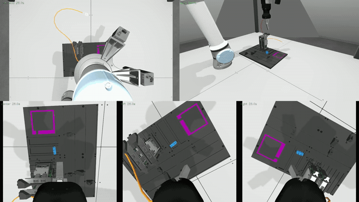

# Robotic cable insertion with geometric vision and contact-aware control

**Yoon Jung** · yoonjung0705@gmail.com

Built an autonomous simulated cable-insertion system for Intrinsic's AI for Industry Challenge, handling both SFP-to-NIC and SC-to-SC tasks around circuit cards. The system combines three wrist cameras, measured robot motion and force with an explicit controller.

| SC-to-SC: detour around three cards, then insert | SFP-to-NIC: insert with two cards present |
| --- | --- |
|  |  |

*Selected successful released-evaluation recordings; GIFs begin at measured motion and play at 2× speed. [Full 20-fps videos](media/final_evaluation/README.md).*

- **Plan for the cable, not just the robot arm.** SC transport follows a low lateral bypass around the card row; an RGB board marker adapts the route to board position and yaw. SFP uses a lift-and-transfer route. This avoids relying on an arm path that ignores the trailing flexible cable.
- **Use geometry to sharpen perception.** Task-conditioned camera history identifies the requested port; crops from original-resolution images preserve fine landmarks for calibrated multi-view pose fitting. Board/rail edge detection established precise yaw estimation during development; the final pipeline uses five port landmarks and a visual board marker. Geometric agreement gates the handoff.
- **Control the held connector, not only the gripper.** Estimate the plug's pose within the gripper, freeze a consistent port frame per attempt, and accept a close-up plug update only after several agreeing observations. An explicit controller aligns and advances the connector; measured forceful stalls trigger a short backtrack and sideways retry.

**Result:** best local replay of the published qualification configuration **276.34/300**; a fixed 19-run batch achieved **53/57 trial insertions and 15/19 complete three-trial passes**. The latest simpler public sample scored **287.90/300**. Published scenes were used for diagnosis, so these results describe a completed prototype rather than unseen-scene reliability.

[Experiments and rejected approaches](EXPERIMENTS.md) · [Technical explanation](answers/2026-10-19-final-project-completion-notes.md) · [Future SERL and hierarchical recovery](FUTURE_WORK.md)
