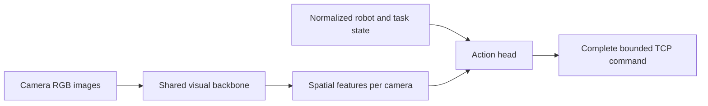

> Retired plan: preserved for provenance. The [current experiment summary](../../../docs/EXPERIMENTS.md) and [single future-work plan](../../../docs/FUTURE_WORK.md) supersede its active/queued instructions.

> **October 18 score target achieved:** **290.19/300**, all three public-sample insertions pass independent depth/lateral/orientation checks; all used-stage p95 inference is below300ms. The analyze/repair/evaluate loop stops after18 completed full samples. V56 preserves three quiet SCcontext frames while sharing initial grasp observations, and seats1.5s above the public1s requirement. Rule transport and explicit RGB/public-state insertion use unchanged perception weights; no learned BCactor or RLactions. Failures and unqualified fits are preserved. This is one selected public-sample pass, with small SCdepth margin and unresolved unusual-SFP-grasp coverage; final scenes stay sealed. Earlier sections are historical. [Results, commands and videos](../../../docs/experiments/2026-10-18-five-repair-cycles.md).

## October 18: gated close-up pose update and SC insertion result

V34 passes **4/4 matched SC development cases** (zero/five obstacle cards, both ports), followed by a passing SC round in the unchanged public sample: **15.510 mm depth, 0.141 mm lateral error, 0.469° orientation**, toolkit completion, no harm. Five fresh agreeing images support one bounded plug-pose update at 25 mm; the port frame stays fixed. Tighter lateral centering and stronger lateral tracking are also needed. All used-stage p95 timings pass; these are explicit RGB/public-state control results, not BC or RL.

The complete sample is **170.57/300, 2/3 strict** because SFP trial 2 has a 3.53° biased grasp estimate before contact. Its actual roll exceeds the original SFP training range; close-up predictions remain wrong. Repeats stop, and the next targeted repair is SFP orientation coverage rather than a stiffness-only change. No new training or collection is running. The SC model's original 1.026° qualification failure remains explicit; four successful development cases do not establish general reliability. Final scenes remain sealed.

[Detailed evidence, commands, images and next repair](../../../docs/experiments/2026-10-18-sc-explicit-controller-continuation.md).

## Current execution branch — October 18

The working pipeline uses rule-based transport, perception of the requested port, and an **explicit image-based insertion controller**. It does not run the learned BC insertion actor. Five fresh, agreeing observations update the held plug's pose at 25 mm. The accepted port stays fixed, and the controller starts its corrected commands from the previously issued reference.

This update now gives full SC insertion in four completed public-sample SC trials. It improves the matched development grid from 1/4 to 3/4; five-card / port 1 remains open. The model is still not generally qualified: its original near validation p95 is 1.026°, so live tests use explicit, limited experimental scopes.

The latest hard SC case passes at 15.538 mm / 0.127 mm / 0.305° after combining the gated close-up estimate with tighter centering and lateral stiffness 500, while keeping axial stiffness 90 and all force limits. The 240 lateral setting fails. V34 adds bit-exact shared JPEG preprocessing and is rerunning all four matched SC cases before three unchanged public samples. No new training or dataset collection is queued. [Current scores and decisions](../../../docs/answers/archive/2026-10-19-documentation/status_full_history.md#october-18-current-explicit-insertion-continuation).

## October 18: current insertion repair

**October 18 current result:** the unchanged three-trial public sample improves152.61→176.85/300 after an explicit-controller seating hold fix, with2/3combined successes(bothSFP). SCstillstopsnear2mm/2.17degrees; learnedBCremains0/8and is not the source of the SFP successes. An exact shared-JPEG preprocessing repair passes3/3liveSFP repeats with acquisitionp95<228ms. Current SC recovery work uses only RGB/public robot state; no newRL or final scenes. [Current cycle and gates](../../../docs/experiments/2026-10-18-three-trial-insertion-repair-cycle.md).

Port perception and held-plug perception are different components. The requested-port stack estimates the opening; a separate RGB grasp estimator estimates where the plug tip is and how it is rotated relative to the gripper. Both estimates are locked during an attempt. Stable predictions can still be biased: SC's old grasp model is stable but inaccurate on nominal-centred grasps missing from its training set.

Current deployment diagnostics use rule transport, fresh visual acquisition, a controlled150→25mm approach, then the full-connector H4 BC actor. Measured transport/approach history survives handoff. A reference governor reduces command jumps but has not improved insertion: its corrected control-only comparison is0/4. It is not promoted. A matched full-data BC comparison tests public controller-reference error as input; its previous-command persistence baseline is strong, so only live alignment/progress/insertion can establish improvement.

A separate two-run SFP image-only servo diagnostic replaces learned insertion with an explicit alignment/advance controller. Its purpose is to test perception/control feasibility, and any success must be labeled rule-controlled, not BC or RL. No newRL/world-model training or reserved-final evaluation is enabled. [Current evidence and plan](../../../docs/experiments/2026-10-17-insertion-control-and-grasp-repair.md).

# Direct visual policy

<!-- current-continuation:start -->
## Current approved continuation — October 16

Rule transport brings either SC or SFP to a visual acquisition hold about 150 mm before the opening. A fresh requested-port pose and RGB-derived plug offset then initialize **one shared learned actor for the entire 150 mm approach and insertion**. Large hierarchical retreats return along measured poses to that acquisition hold and require fresh perception. The old 30 mm controller is historical.

**Training is running:** matched ImageNet versus visual-only transport initialization, same 13.725M full-target transformer, 30,000-update budget per arm. The fresh arm is active; the warm arm follows automatically. Actor data contain **67,039 examples from 500 usable source episodes / 377 physical reset configurations**: SC 102/30 train/validation episodes, SFP 319/49. All wider-source admission and estimated-frame audits passed. Predictions are complete recorded command targets in the visually estimated port frame, with causal robot/pose history and no privileged geometry input. Training error is not autonomous insertion success.

**Mandatory refiner retraining is complete**, including SC and SFP: 72,857 native RGB triplets from 497 original source episodes, followed by a targeted 20-episode SFP acquisition extension. Both base and repair reached validation plateaus. The strict repaired SFP offline component gate passes with the 0.95 projection threshold; this projection flag is not calibrated confidence or certified physical visibility.

**Launcher audit correction:** several newer host environment settings were not forwarded into Docker. The recent SFP live10 result remains 10/10 correct acquisitions, but actually used projection threshold **0.90**, not the intended 0.95. The active SC broad60 uses the **new repaired native refiner**, not the separately specified older SC checkpoint. Preserve these results under their actual configuration; they do not certify the intended family bundle. Let the frozen SC job finish. A separate corrected launcher records the effective container environment and forwards these settings for subsequent matched tests. The original launcher/source hashes remain intact during active evaluation.

The hierarchical runtime is implemented, including retained pre-return RGB/state, coherent lateral supervisor retries, measured route retreat and reacquisition. **28 focused contract/recovery checks pass; live actor/recovery validation is still pending.** Supervisor exploration is not RL. No new SAC/SERL, reward model, imagination or reserved-final evaluation has run. Keep final scenes sealed and at most four project GPUs including untouched legacy GPU0.

Next: finish matched BC fits and current frozen SC acquisition evaluation; verify corrected runtime settings; run fresh autonomous full-depth development rollouts, diagnose failures, then compare no/local/hierarchical recovery with identical actors and scenes. Advance to RL only after the supervised insertion gate.

See [execution record](../../../docs/experiments/2026-10-15-rule-perception-hierarchical-execution.md) and artifact `state.json` for exact commands, failures, comparisons and paths.

**Additional SC coverage repair:** the29 existing rail-expansion episodes added4,526 RGB-proposed native crops (22/7 complete train/validation episodes) after label/split/visual QA. The joint SC+SFP repair reached a validation plateau at4,000updates. It passes9/9 previously rejected SC probes versus0/9 for both baselines, and improves new-rail accepted components166→211. Overall accepted components3722→3711 is a small regression; zero wrong/absent accepts remain. The original strict gate failure is preserved. A separately documented20-scene live diagnostic is running; the new checkpoint is **not promoted**. Black-gripper-only crops explain some large pixel-error tails and are not evidence of visible targets. Active frozen models/scenes remain unchanged.

<!-- current-continuation:end -->


## October 15 autonomous continuation: current evidence

### October 16: acquisition repair and actor-data readiness

**No new insertion BC or RL checkpoint has been trained yet.** Mandatory SC/SFP native port refiner retraining is complete to plateau. The approved learned actor still owns the entire 150 mm approach, with starts buffered to 180 mm. Large retreats must return to a measured acquisition checkpoint and obtain fresh port/grasp locks.

- **SC:** the old checker run stopped under its failure rule at 36 qualified / 41 completed of 60 planned, zero wrong ports/harm. Its code is archived with all eight frozen source hashes verified. The new single-request native-five pipeline, bounded 140 mm visual correction and measured hold gate achieved **7/7 correct acquisitions**, opening errors 0.077–0.363 mm and zero wrong/harm. All global inference p95 values are below 128 ms; one perception-active subset is 306.8 ms. Thus its stricter latency gate is **6/7, still open**. A same-scene diagnostic separates Gazebo rendering from policy inference while respecting four project GPUs. Models/scenes are unchanged. A single-point 64 px relaxation remains rejected because it accepted an absent target; the replacement five-landmark geometry rejects that case.
- **SFP coarse:** full-data recorded-image performance improved substantially, but the unchanged live six-case gate remains 3/6. Existing image history did not repair the three failed traces. A bounded twenty-reset acquisition-state repair is collecting ten training / ten validation configurations across 1–5 cards, both ports and all requested card codes, then fitting source-balanced current/history heads while retaining the full old corpus. The first two all-camera label overlays were inspected. It predicts projected-in-frame status, not certified physical visibility or learned confidence. Require at least 9/10 fresh correct acquisitions and zero wrong/harm before promotion; otherwise change the representation instead of routine recollection.
- **Grasp estimate:** a separate native SFP plug-offset model plateaued after 15,000 updates on 6,115 triplets from 307/47 train/validation sources. Across all phases its position p95 is 0.505 mm, failing the 0.4 mm gate; worst images hide the plug inside the port. In the actual runtime acquisition scope—after a causal visual port lock, with public measured TCP at least 120 mm before the opening—position p95 is **0.150 mm on 272 observations / 39 held-out episodes / 31 resets**. Translation is approved only for that scope and is locked before insertion. Orientation remains diagnostic and is not an actor input. Do not update this estimate from an inserted, hidden plug.
- **BC data:** 454 qualified original expert sources now have causal RGB port locks. Requiring a legal three-observation grasp lock leaves **432 sources / 51,667 rows**: SC 80/20 train/validation episodes and SFP 293/39. The other 22 successful SFP recordings are preserved, not called bad experts; they lack an approved early free-grasp lock. Earlier rows are never backfilled. Original data remain untouched, with a separate exact actor-pixel cache on NAS.
- **Wider demonstrations:** SC first-thirty admission passed: 22/30 physically qualified episodes, from ten original training reset configurations. All three SFP pilots at 90/150/180 mm, including lateral/8-degree offsets, fully inserted at 46.776 mm depth and 0.247–0.382 mm lateral error without scored harm. These are privileged teachers, not learned-policy successes. SFP first-thirty collection reuses those three pilots. Ten held-out wider starts per family are queued before the matched BC comparison.

Preflight fixes for the upcoming actor: complete port-frame targets for both families, exact recorded force/trajectory profile, plug-based near-port phase weighting, command-feedback masking in BOTH current and historical state, and identical native-JPEG preprocessing during training and deployment. The old 15 mm command cap would clip about 11% of SC and 27% of SFP expert chunks; the new controlled runtime must use the audited 60 mm component cap. Visual warm starts now reject silently empty/incompatible transfers; the comparison retains fresh current-data state normalization. Four real history offsets are planned, with the history-masking ablation OFF.

Rootless runs use private bridge networks and unique Gazebo partitions. Cooperative per-GPU locks serialize future rollout/training workers without interrupting active jobs. Legacy GPU0 is untouched. Current work uses GPUs3/4/5 plus that legacy allocation. Final scenes remain sealed; reward/imagination and new actor-Q training remain gated. See the [execution record](../../../docs/experiments/2026-10-15-rule-perception-hierarchical-execution.md) for commands, failed comparisons and artifact paths.

### Latest: rail coverage, clean simulation isolation and rule pilots

**Current gates remain open.** Mandatory native refiner retraining is complete to plateau on both families, but live acquisition still needs repair before the new 150 mm insertion actor can be trained and promoted. No new insertion BC or RL actor has been trained in this continuation.

The SC coarse failure has a concrete data gap: old SC0 rail translations cover roughly −2 to +18 mm and SC1 −60 to −43 mm, whereas the released range spans −60 to +55 mm. Even the 95 failed original collections do not fill that gap. An old-layout current/history locator fit cannot establish generalization to these missing port arrangements. The bounded repair collects 29 new physical reset configurations across the rail range, both requests, 1–5 cards and absent-other-port negatives. These are perception-only recordings, not successful insertion experts. Native overlays from the first two runs were inspected and passed causal-label QA. Current/history fits use grouped splits and balance original versus expanded-layout sources; live correct-port acquisition remains the promotion gate.

The first six SFP rule-transport cases yielded **1/6 fully qualified acquisitions, zero wrong-port handoffs**. The one pass stopped about 148 mm before the port, 5.7 mm laterally off-axis, with 0.324 mm visual opening error. Several failures waited at the elevated acquisition plane without a usable visual lock; another reached the region but could not sustain the stability gate. A bounded matched pilot tests acquisition at the nominal 150 mm plane. It does not relax the visual handoff gate. This is rule transport only; no insertion actor ran.

Three repaired SC teacher starts now pass independent raw-bag terminal checks, including 150/180 mm lateral/orientation offsets. Depth is 15.57–15.59 mm, lateral error 0.15–0.46 mm, with no scored harm. A smaller reset integral gain fixes measured oscillation, and 6 mm/s axial insertion reaches full depth before the simulator completion event freezes motion. These are privileged teacher demonstrations. Restart only the bounded 30-attempt teacher gate with this controller; require at least ten independently qualified successes before expansion.

BC preparation now has **53,921 command rows from 454 qualified source episodes**, including SC and SFP. All sources have matching completion events; 4,822 later commands are excluded. Episode IDs include source-path hashes to avoid basename collisions. Four labels are actual active complete TCP targets at +50/+100/+150/+200 ms. Original data are preserved. Body-command conversion uses preceding header-time TCP and is explicitly an approximation to RT-consumption state; a four-episode audit measures p95 discrepancy of 0.07–0.12 mm. Causal RGB-derived port locks are still needed before this becomes an actor-ready dataset.

A confirmed infrastructure bug affected two later runs: concurrent host-network containers shared Zenoh port 7447 and Gazebo discovery despite separate ROS domains. Both launchers now use private bridge networks and unique Gazebo partitions. Audits found no conflict warnings in the 454 admitted original sources or the frozen 12-run SC comparison. Failed infrastructure runs remain preserved and excluded from policy evidence.

See the [execution record](../../../docs/experiments/2026-10-15-rule-perception-hierarchical-execution.md) and artifact-root `state.json` for commands, exact counts, failures and subsequent updates. Earlier October 15 paragraphs below are intermediate history where they describe running jobs or older derivatives.

### Latest acquisition gate and BC-data preparation

The completed frozen SC comparison failed promotion: old stack **3/6** correct acquisitions, new point refiner plus association **1/6**, zero wrong accepts in either arm. No insertion actor ran. The bounded replacement of the legacy presence veto then accepted the neighboring port in **1/1** diagnosis (56.21 mm opening error): **rejected**, not a safe fix. Exact-frame replay reproduces the association scores to within 0.000041 and finds contradictory identity evidence in one camera; there is no established simple state-range or frame-conversion explanation.

A distinct crop-proposal repair is being tested: a public-request-conditioned locator chooses one SC region per camera from all three current RGB feature maps and optional 40 mm / 10 degree motion-spaced context. It omits absolute TCP coordinates and retains relative motion for history. On 83 training / 21 validation episodes, current-only and history heads both reach about 10.9 px coarse p95 with zero nearest-wrong-port views among 14,235 labeled in-frame views. Both initial fits hit an update cap; separate weight continuations seek a plateau. Fresh live diagnosis remains necessary. This predicts projected-in-frame status, not certified physical visibility.

The first BC command derivative contains 46,910 rows from qualified original sources, but 78 sources had stale archived image paths. A corrected derivative is rebuilding from the audited native-image provenance fallback. Original datasets and failed derivatives remain intact. Robot state is reconstructed as 32 dimensions from preceding controller/joint/wrench observations; actual public task codes have 10 dimensions. Four labels are the recorded active TCP targets at +50/+100/+150/+200 ms. Targets held between message publications remain genuine command supervision. Static pauses are thinned in the copy without joining actions across removed time. No future measured pose supplies an action label. Six QA panels were saved and SC/SFP examples visually inspected. Estimated port locks must still be produced before actor training.

All three initial wider SC teacher successes passed a separate raw-MCAP, pre-return audit: depth about 15.568 mm, lateral 0.082–0.117 mm, orientation about 0.012–0.013 degrees, no scored harm. A bounded 30-attempt batch covers both ports and 1–5 cards with 90/150/180 mm starts and offset perturbations. Some supervisor resets fail; these are not BC experts. Diagnose the completed batch before expansion; at least ten independently qualified successes are required. A successful teacher video is `wide_approach_pilots/wide_sc_pilot_02_event_v5/five_cameras_20fps_grid_active.mp4` under the artifact root.

The approved pipeline is rule transport → requested-port acquisition/refinement → one shared learned insertion actor owning the full 150 mm approach. Training should buffer starts to 180 mm. Large hierarchical retreats return to rule transport and require a fresh visual lock. The old 30 mm controller is a historical control, not part of this pipeline. BC and recovery comparisons remain open; no new RL has been trained in this continuation.

**Refiner retraining is now complete to a validation plateau.** The corpus contains 72,857 original RGB triplets from **497 source episodes / 633 named image streams / 422 physical resets**. These are different counts; image-stream IDs must not be counted as independent episodes. Source episodes: SC 83 train / 21 validation, SFP 340 train / 53 validation. Physical reset groups are disjoint across splits.

A matched SFP component test combines the stronger requested-port coarse locator with the new native refiner. The five-landmark pose variant accepts 356/1,120 sampled triplets with zero wrong-port accepts, versus 324 accepted by the old component. Conditional position/lateral/orientation p95 is 0.447 mm / 0.189 mm / 0.708 degrees. It fits translation and yaw using a training-only fixture normal prior; arbitrary tilted fixtures are not established. The set has 70 image-stream IDs but only 53 source episodes / 45 physical resets. These are component results, not autonomous insertion success. Preloaded-image perception p95 is 20.46 ms; complete live latency remains unverified.

A diagnostic global orientation head previously used simulator card count, which is absent from the public task. Those old results are quarantined and must not support deployment claims. Its corrected public-input control has now plateaued: SC/SFP angular p95 2.33/3.27 degrees, versus state-only 4.80/4.08 degrees. The native landmark fit above remains the more precise component candidate.

Independent geometry, official insertion score and contact/force records admit **454 source episodes** for subsequent BC preparation: SC 80 train / 20 validation, SFP 307 train / 47 validation. This is an admission index, not yet a materialized action-chunk dataset. Ownership, image-time state joins, stall cleaning and predicted-frame targets remain mandatory. Original data are untouched. Failed or shallow recordings can remain useful for perception without becoming successful BC experts.

The wider SC teacher now demonstrates full insertion from all three diagnostic starts, including a 180 mm approach and lateral/orientation offsets. The third case originally returned before the simulator contact timer completed; waiting for the teacher-only completion event fixes its official score to 75. These are privileged teacher demonstrations, not actor successes, and require independent raw-bag geometry/force checks before expansion. The first 30 wider attempts must contain at least 10 qualified full insertions before collection scales.

The frozen six-configuration/two-arm SC acquisition comparison has completed and failed its gate. The legacy-veto replacement also failed a wrong-port test; see the latest update below. No final scenes have been opened.

Artifacts and exact commands: `/home/nas/chmin/aic_archives/2026-10-15_rule_perception_hierarchical_v1/`. Detailed chronology: [execution record](../../../docs/experiments/2026-10-15-rule-perception-hierarchical-execution.md).


**October 15 execution update:** Broad SC/SFP native refinement now improves opening-position accuracy: conditional SC lateral p95 is 0.20 mm; the stronger SFP coarse pipeline plus the new refiner improves lateral p95 from 0.82 to 0.29 mm on 70 validation recordings, with zero observed wrong-port accepts in that comparison. Training continues because the first 12,000-update fit was still improving. Coarse identity repair remains experimental: rejecting known wrong handoffs also rejects some correct ones. Wider 150/180 mm SC teacher pilots now reach full seating after measured alignment and a corrected completion condition; broader data admission is still gated. New insertion BC, deployed hierarchy and RL have not passed their gates. [Evidence and active execution](../../../docs/experiments/2026-10-15-rule-perception-hierarchical-execution.md).


**October 14 current execution:** Supported normal-board SC rule transport and RGB handoff passed small screens. Matched corrective-data, decoder and 6-second robot-history repairs did not pass autonomous full insertion. A separately frozen observation-only approach reached **29.12 mm before the opening / 0.148 mm lateral**, then the unchanged trained actor achieved **11.07 mm insertion depth / 0.413 mm lateral / 0.94° orientation error** on one reused start. Official score 75, but the unchanged ≥14 mm physical gate failed. Logs confirm contact-triggered completion and end-effector locking; no cable snag explains this run. This is meaningful approach progress, not a promoted insertion policy. All new jobs finished; no routine collection, RL, world-model work or final-scene access. SFP local insertion, rotated SC and port-0 rail minimum remain unapproved. [Execution record](../../../docs/experiments/2026-10-14-transport-handoff-execution.md) · [Easy explanation](../../../docs/answers/2026-10-14-autonomous-execution-outcome.md).

**Current handoff direction (October 2):** This page documents the older
direct-visual actor and transport comparisons. The active supervised plan is
[transport proposal, selected-port pose/visibility verification, and a
separate port-relative insertion actor](SELECTED_PORT_HANDOFF_PLAN.md). The
integrated switch and autonomous full insertion remain open.

## October 1 controlled transport comparison

A fresh frozen ImageNet three-camera representation was used to compare current-frame and 60-second causal-history transport heads, predicted route stage/subgoal/handoff, a four-target diffusion transformer, and separate SFP and SC heads. Each predicts complete TCP-body target poses; live actors receive only ordinary images, measured state, and public task encoding. The long-history head reached 8 mm of the teacher SFP pre-insertion standoff on one bounded development scene but still had 6.9° orientation error and no insertion. It regressed on one SC five-card scene. Explicit route subgoal p95 remained 44.5 mm, diffusion first-action p95 about 12–13 mm, and task-specific heads did not beat the shared deterministic head. No actor was promoted; [the complete experiment record](../../../docs/experiments/2026-10-01-transport-five-way-comparison.md) has commands, metrics, traces, and videos. A previous 16-second history candidate that reused failed policy features was only evaluated offline; this new history candidate was also tested live.

## September 30 transport continuation

**Current matched data:** v9 has two fully inserted Cartesian SC episodes (one per port in the exact same five-card world): 1,751 transport and 503 local training chunks. The older failed-insertion transport prefix remains archived in v8 and is excluded from v9. The paired teacher scored 75 at Tier 3. The equal-port shared transport BC run completed 1,500 updates, but failed on both autonomous development starts (103/603 mm planned-standoff error, 0/2 insertion). This is not an autonomous insertion result.
The teacher transport gate is accepted. The current two-actor continuation is documented in [the execution record](../../../docs/experiments/2026-09-30-transport-to-two-actor-continuation.md). This does not mark autonomous full insertion as successful. Control-matched SC dataset v8 has one fully inserted source and one reviewed transport-only prefix; failed insertion actions are excluded. Existing 268 SFP episodes retain their physical-reset split. The original successful SC local data remains separate. Ten learned candidate rollouts across the same two held-out starts failed; the controller-error mask improved v8 behavior but v9 paired-port training regressed. Routine feed-forward transport BC is stopped pending a bounded route-subgoal/progress diagnosis. No new RL or final-scene evaluation is started. Historical model results below refer to their own checkpoints and evaluation gates.


Implemented 2026-09-17 from the
[June 17 architecture notes](https://github.com/yoonjung0705/tutorials/blob/master/python/libraries/tutorial_aic.md#617-2026-hybrid-train-branch-model-training-especially-for-isaac).
See the [model checks](../../../docs/experiments/2026-09-17-direct-visual-policy.md) for measured
results and [live validation](../../../docs/experiments/2026-09-17-live-validation.md) for
scored trials, videos, and the current reset/control/data blockers.

## Architecture



`actor_mode=direct_visual` is the offline CLI default. The same
[actor implementation](../../../aic_utils/lerobot_robot_aic/lerobot_robot_aic/direct_visual_actor.py)
loads in offline learning, Isaac, and Gazebo. Images directly affect the action
head. There is no ACT action proposal, residual addition, correction clip, or
ACT preservation objective. TCP delta pose remains the controller's command
format: “direct” means the model predicts that entire command.

| Setting | Behavior |
| --- | --- |
| `--actor-backbone resnet18` | ResNet18 initialized from scratch; optionally copy ACT visual weights with `--actor-backbone-checkpoint <pretrained_model>`. ACT's decoder/action head and normalizer are not copied. |
| `--actor-backbone resnet18_imagenet` | ImageNet initialization from torchvision. |
| `--actor-backbone dinov2_vits14` | Official pretrained DINOv2 ViT-S/14. Code is pinned to revision `7764ea0f912e53c92e82eb78a2a1631e92725fc8`; first use downloads code/weights into Torch's cache. |
| `--actor-backbone small_conv` | Small convolutional network for quick implementation checks. |
| Backbone training | Enabled by default. `--freeze-backbone` is an explicit ablation. ResNet uses fixed batch-normalization statistics for small batches; its convolutional weights train. |
| Spatial information | Each camera retains a 2×2 feature grid. The model uses a shared backbone and a fixed, recorded camera order. |
| Normalization | State/action statistics fit training episodes only. Image inputs are float RGB in `[0,1]`, resized and ImageNet-normalized inside the actor. Statistics are saved in checkpoint buffers. |
| Action limits | One positive physical limit per coordinate; defaults are 0.02 m for translation and 0.2 rad for rotation. Choose limits for the intended control rate/start distribution and save them with the model. |
| Action horizon | One step for RL. Offline transitions advance one frame, so multi-step action chunks are allowed only with `bc_only`. |

The current RL update is a deterministic actor-critic with twin Q networks and
optional BC. SAC entropy tuning, a TD3 target actor, and target-policy smoothing
remain possible algorithm changes. The current critics retain their existing
encoder options; DINOv2 support in this change is on the actor.

Legacy `act_adapter` and `act_direct` modes remain explicit for historical
checkpoints. The older Hydra experiments and stateful/axial recipes select these
legacy paths. Use the direct visual entry points below for new architecture work.

## Bounded offline run

Check `nvidia-smi` and choose an idle physical GPU. These examples use one GPU;
keep the total across concurrent work at **four GPUs or fewer**. Routine commands
use the existing user environment and require no sudo.

The existing dataset has label and split problems found by the
[demonstration audit](../../../docs/experiments/2026-09-17-live-validation.md#demonstration-audit).
The command below reproduces an implementation smoke; repair those problems
before using it for an architecture comparison.

From the repository root:

```bash
export AIC_GPU=0
export AIC_DIRECT_RUN="outputs/experiments/$(date -u +%Y%m%d_%H%M%S)_direct_visual_bc"
CUDA_VISIBLE_DEVICES="$AIC_GPU" OMP_NUM_THREADS=4 \
  .pixi/envs/default/bin/python aic_utils/lerobot_robot_aic/scripts/train_vision_offline_serl.py \
  --dataset-root outputs/hf_combined/clean_sfp_to_nic_sc_to_sc_task_conditioned_contact_features_h264 \
  --output-dir "$AIC_DIRECT_RUN" \
  --actor-mode direct_visual --actor-backbone resnet18 \
  --actor-backbone-checkpoint outputs/train/clean_sfp_sc/act/bc/20260510_clean_act_nact8_400k/checkpoints/175000/pretrained_model \
  --actor-update-mode bc_only --reward-mode zero --action-horizon 1 \
  --batch-size 4 --steps 40 --seed 17 --save-every 40 \
  --val-fraction 0.05 --val-every 20 --val-max-batches 2 \
  --max-wall-time-minutes 5
```

To use DINOv2, select `--actor-backbone dinov2_vits14` and omit the ACT backbone
checkpoint argument. ACT pretraining is optional. For Q-based offline learning,
first validate reward labels and select `q_bc` with the appropriate reward mode.
`final_success` assumes every episode ends successfully and is unsuitable for
unfiltered failed/incomplete demonstrations.

The smoke above evaluates only eight held-out frames per validation pass. It
checks the learning path. Use episode/scene-balanced evaluation across the full
held-out set before selecting a policy.

## Inspect the saved actor

```bash
CUDA_VISIBLE_DEVICES="$AIC_GPU" OMP_NUM_THREADS=4 \
  .pixi/envs/default/bin/python aic_utils/lerobot_robot_aic/scripts/evaluate_vision_offline_serl_actor.py \
  --dataset-root outputs/hf_combined/clean_sfp_to_nic_sc_to_sc_task_conditioned_contact_features_h264 \
  --checkpoint "$AIC_DIRECT_RUN/checkpoint_latest.pt" \
  --batch-size 8 --max-batches 4 --num-workers 0 \
  --output-json "$AIC_DIRECT_RUN/heldout_actor_check.json"
```

This evaluates imitation error, a zero-action baseline, and image sensitivity
on 32 held-out frames. It does not run simulation. Missing weights/schema keys
fail loading. A saved direct visual checkpoint includes the backbone, action
head, normalization, action limits, and architecture config. It needs no ACT
TorchScript or ACT normalizer at inference. DINOv2 also needs its pinned model
code in Torch's cache or network access on first load; include that dependency
when preparing a container.

## Isaac and Gazebo entry points

The Isaac launcher recognizes `direct_visual` checkpoints and selects one-step
execution with zero residual/preservation penalties. Preview the command first:

```bash
.pixi/envs/default/bin/python aic_utils/aic_isaac/scripts/train_isaac_online_serl.py \
  --checkpoint "$AIC_DIRECT_RUN/checkpoint_latest.pt" \
  --steps 20 --updates 0 --dry-run
```

This generates a plan only. A real run needs the [Isaac container setup](../../../docs/WORKFLOW.md),
an explicit episode/reset configuration, and recorded success geometry. Use
zero updates/exploration for evaluation. History and runtime clipping overrides
are rejected when they would change the saved direct actor contract.

For official Gazebo evaluation, follow the [dedicated-container workflow](../../../docs/WORKFLOW.md),
changing the evaluator selection to:

```bash
--run-dir "$AIC_DIRECT_RUN" \
--checkpoint-glob 'checkpoint_latest.pt' \
--policy-module aic_example_policies.ros.RunDirectVisualSERL \
--n-action-steps 1 --command-mode delta_pose --command-frame gripper/tcp
```

These are arguments to `scripts/evaluate_act_checkpoints_runtime.py`, not a
standalone shell command; omit `--act-torchscript`. The runner uses the existing
`AIC_SERL_*` runtime settings and defaults to zero translation/rotation deadband,
so small insertion commands are preserved. The bridge transfer validator also
accepts `--policy-kind direct_visual` without an ACT export. Runtime commands
were exercised live: the direct actor completed one official Gazebo trial
without insertion, and Isaac loaded it for zero-action reset diagnostics. The
Isaac checks did not evaluate learned actions. See the [live report](../../../docs/experiments/2026-09-17-live-validation.md).

## Next comparisons

Live checks and the dataset audit are now complete, with blocking findings.
The following sequence remains gated on repairing those findings; see
[current priorities](../../../docs/answers/archive/2026-10-19-documentation/status_full_history.md#next-experiments-in-order).

1. **Validate resets, action direction, and the expert start fix.** The two
   CheatCode variants now preserve depth for aligned final-descent starts.
   Confirm behavior with inserted/near-port/uninserted resets before generating
   more demonstrations. Keep official success separate from the handoff gate.
2. **Audit demonstrations and split by scene.** Check success labels, failed
   endings, task balance, action magnitudes, and contact phases. Hold out board,
   port, and reset configurations; random adjacent-frame splits can leak scenes.
3. **Compare representations under one contract.** Test ACT-initialized ResNet,
   ImageNet ResNet, DINOv2, and scratch initialization with identical data,
   action limits, and evaluation. Measure latency/memory as well as success.
4. **Add contact memory deliberately.** Compare a short force/proprioception
   history or recurrent head, and finer image crops near the connector. These
   require new recorded observation schemas and matched runtime preprocessing.
5. **Choose one RL algorithm before scaling.** A TD3-style actor/critic update
   and DrQ-style image augmentation are reasonable controlled comparisons.
   Their papers support these as general methods; benefit on this task is an
   untested hypothesis. See [TD3](https://proceedings.mlr.press/v80/fujimoto18a.html)
   and [DrQ-v2](https://arxiv.org/abs/2107.09645).

### October 16 continuation

Mandatory SC/SFP native refiner retraining is complete to plateau. The targeted SFP coarse repair also plateaued; on the same 1,120 held-out triplets it accepts 917 versus the old 913, with zero wrong ports. Native refinement rejects all 14 new coarse absent-target false positives. The ten-case live gate is still running; this small component change is **not** a live success claim. Its first failure reaches the correct image region but exceeds the native geometric residual gate. See the [execution record](../../../docs/experiments/2026-10-15-rule-perception-hierarchical-execution.md) for the inspected predicted/label overlays, full metrics and bounded diagnosis.

The new `RunRuleThenSharedRecovery` integration is implemented but unvalidated: SC/SFP rule transport -> fresh RGB port/grasp locks -> one shared actor owning the entire150mm approach -> measured-path local/hierarchical backtrack. Large retreats return to the measured acquisition checkpoint and require fresh perception. Pending chunks/history are cleared, contact never retares initial load, and supervisor commands are logged separately. **No new insertion BC or RL has been trained yet.** Wider training/held-out demonstrations and matched fresh versus visual-warm BC remain in progress. Final scenes remain sealed and the project limit is four GPUs including the untouched legacy allocation.

SC's targeted separate-GPU latency case passed (active p95 239ms, opening error0.414mm); the earlier seven-case single-GPU strict result remains6/7. Current status and exact artifacts are in [STATUS.md](../../../docs/answers/archive/2026-10-19-documentation/status_full_history.md) and the execution record.
